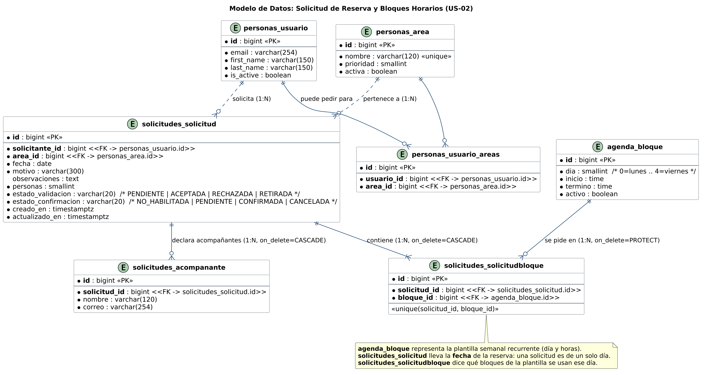

# Diagramas

## Comportamiento

Hay un diagrama de secuencia por escenario de cada historia. Están dibujados
desde el código: cada flecha es una llamada que existe en `main`.

### Cómo leerlos

| Elemento | Qué representa |
|---|---|
| Participante | Una parte del código con el nombre que tiene ahí (`personas.views`, `agenda`, la base) y, debajo, el archivo que la implementa. |
| Color | La capa: azul es presentación, morado es dominio y verde es persistencia. |
| Flecha | Una llamada, escrita como en su línea de código. Hacia la base, solo la operación SQL y la tabla. |
| Flecha a sí mismo | Una línea de código que esa parte ejecuta por dentro. |
| Comentario (`#`, en gris) | Lo que hace la línea de código de abajo, en palabras. Va en las más largas. |
| Barra de activación | La llamada en curso. Toda llamada abre una, también las internas. |
| Retorno (punteado) | La variable donde queda el resultado. Lo que vuelve de la base es `fila` o `filas`. Lo que no devuelve nada, como `save()`, no tiene retorno. |
| Respuesta al actor | El código HTTP y la plantilla o la dirección, como `200 · uso/bloques.html`. |
| `alt`, `opt`, `loop` | Ramas, pasos opcionales y repeticiones, con la condición entre corchetes. Si un retorno decide la rama, cada rama lleva el suyo. |
| `break` | Una salida anticipada, como un `400` o un `404`. |
| Nota | Por qué el código hace ese paso. |

Los argumentos se acortan cuando no cambian lo que pasa, y dentro de un
formulario `self.instance` es el modelo que se le pasó. El control de acceso por
rol (`staff_member_required`, `user_passes_test`) corre antes de cada vista y no
se dibuja.

### Inicio de sesión (US-01)

Las cuatro puertas, `/solicitante/entrar/`, `/configuracion/entrar/`,
`/validacion/entrar/` y `/apoyo/entrar/`, son la misma vista `entrar` con otros
argumentos: cada una dice qué rol deja pasar, a qué panel lleva (`destino`) y
qué título muestra. La plantilla, la autenticación y el bloqueo son los mismos
para todas. `/login/` solo redirige a la del solicitante, para no romper enlaces
viejos. Los diagramas siguen al solicitante, que es el rol de US-01, y van
separados por cómo termina el intento: con la clave correcta, con la clave
incorrecta o con la cuenta bloqueada.

`_puede_pasar` se revisa después de autenticar y antes de `login()`. Sin el rol
de la puerta responde el mismo error que una clave mala, sin abrir sesión y sin
sumar un intento, porque la clave era correcta (AC4).

`django.contrib.auth` busca la cuenta y revisa la clave a través de
`personas`, porque `Usuario` es el modelo de usuario del proyecto. La busca sin
distinguir mayúsculas (`get_by_natural_key`), igual que la vista que cuenta los
intentos: así un correo escrito con otras mayúsculas no suma fallos.

Con la cuenta bloqueada la clave se revisa igual y la respuesta es el mismo
aviso que una clave mala: ni el texto ni la demora dicen que la cuenta existe.

Cuando la respuesta es 200, htmx reemplaza solo el formulario y conserva el
correo escrito.

La recuperación de clave (AC6) no tiene diagrama propio: son las cuatro vistas
que trae Django (`PasswordReset`, `Done`, `Confirm` y `Complete`), con enlace
firmado y sin tabla nuestra. El proyecto solo pone las plantillas.

### Elegir el área académica (US-02)

La solicitud siempre queda vinculada a un área, así que es lo primero que se
resuelve. Sin áreas activas no hay formulario; con una sola, el asistente la
fija solo y sigue al paso 1; con varias, pasa por `/solicitar/area/`. El área
queda en la sesión, como todo lo que se elige antes de enviar.

Cambiar de área desde el paso 1 (`?cambiar=1`) borra el día y los bloques ya
elegidos, porque se habían elegido para la otra.

### Elegir el día y los bloques (US-02)

Todos los pasos del asistente parten igual: `solicitar` lee las áreas activas
del usuario y `SolicitudWizard.ajustar_area` fija la única que tenga, o lo
manda a elegir si tiene varias y falta o dejó de estar activa. Después
`validar_acceso` decide el paso: si la sesión no completó los anteriores, se
atiende el primero que falta.

La fecha y los bloques los valida `SeleccionHorarioForm`, que es la misma regla
del calendario público: la fecha, con formato y dentro de los límites de
reserva, y los bloques, que sigan libres para ese usuario. Un bloque que el
usuario ya tiene pendiente se rechaza aquí, igual que la pantalla lo
deshabilita. Si todo es válido queda en la sesión y se pasa al paso 2; si no,
vuelve el calendario con el error y lo que ya tenía elegido.

### Completar los datos de la actividad (US-02)

`SolicitudForm` se usa sin el campo de términos (`exigir_terminos=False`),
porque se aceptan en el paso 3. La cantidad de personas y las filas de
acompañante están en formularios distintos, así que la regla que las cruza
(AC6) vive en `services.revisar_acompanantes`.

### Enviar una solicitud de reserva (US-02)

El envío es el paso 3 del asistente y exige aceptar los términos y condiciones
(AC10). El guardado es una transacción atómica dentro de
`guardar_solicitud_completa`: la `Solicitud` con la fecha elegida y la validación
pendiente (AC5), un `SolicitudBloque` por bloque y los acompañantes declarados
(AC6). Si un bloque está inactivo, ya tomado o ya pedido, la transacción se
deshace entera y la vista vuelve a mostrar el paso 3 con el error.

Al guardar se limpia la sesión del asistente y se redirige a
`/solicitar/enviada/<id>/`: recargar no reenvía el formulario. La confirmación
lee la solicitud de la base, solo si es del usuario, y muestra su estado actual.
`SolicitudBloque.save()` vuelve a llamar a `clean()` después de `full_clean()`,
así que las consultas de validación de cada bloque se hacen dos veces.

### Abrir el panel del validador (US-07)

`validacion.cargar()` lee las solicitudes pendientes desde hoy que tienen
bloques, con un número fijo de consultas: las solicitudes con su área y
solicitante, y después sus bloques y acompañantes en dos consultas para todas.
Devuelve la forma que espera la plantilla, que no sabe de modelos. La pestaña
Validación del administrador es la misma vista con otro envoltorio:
`panel_validacion_admin` incluye `_validacion.html` dentro de `panel.html`.

El resto ocurre en el navegador. `panelValidador`, el componente de Alpine de
`_validacion.html`, parte cada solicitud en pedidos (un bloque en una fecha) y
de ahí arma los topes, ordenados por prioridad del área, y las tarjetas sin
tope.

### Resolver una solicitud con tope (US-07)

Se aprueba o se rechaza la solicitud entera. Aprobar una que choca con otras
las rechaza enteras con el mismo motivo, por eso el motivo es obligatorio: es
lo que les llega a quienes pierden (AC4). `resolver()` bloquea la solicitud y
sus rivales en orden de id, así dos validadores que deciden el mismo bloque a
la vez quedan en fila y el segundo ve lo que hizo el primero (AC3). Cada
resolución queda con `resuelta_por`, `resuelta_en` y `motivo_resolucion` (AC5),
y el correo sale solo cuando la transacción se confirma.

La pantalla cambia solo si el servidor respondió `{"ok": true}`. Si la sesión
venció, la respuesta es la página de ingreso y no JSON, y el panel avisa que no
se pudo guardar.

### Resolver una solicitud sin tope (US-07)

Sin rivales, aprobar no pide motivo. Rechazar sí, y se confirma en la misma
tarjeta. Si otro validador ya la resolvió o el solicitante la retiró, el
servidor lo dice y el panel lo muestra.

### Guardar los parámetros del sistema (US-04)

La bitácora de quién cambió qué es el AC4, y es lo que obliga a que el guardado
sea una transacción: unos parámetros cambiados sin su fila de bitácora son justo
lo que el criterio pide evitar.

El rango se escribe una sola vez, en los validadores del modelo, y lo revisa el
servidor. La vuelta por redirección es para que recargar no reenvíe el
formulario y duplique filas en la bitácora. `changed_data` deja fuera lo que no
cambió, así que guardar sin tocar nada no ensucia el historial.

### Editar la plantilla semanal de bloques (US-04)

Un bloque es un tramo de la semana, no una fecha: el cambio vale para ese día
todas las semanas, y por eso solo se edita en la vista semanal. Agregar,
cambiar, quitar y reponer comparten vista porque las cuatro devuelven la misma
rejilla. Quitar y reponer llegan con su `accion`; agregar y cambiar son el
mismo botón, y los distingue si viene o no el `pk` del bloque. Un alta con un
día fuera de lunes a viernes no llega al formulario: la vista contesta 400.

Cada respuesta es la rejilla completa: htmx reemplaza `#calendario` entero y
Alpine arranca de nuevo sobre el fragmento. Sin htmx el formulario se envía
normal y `_responder` contesta con una redirección a
`/configuracion/bloques/?vista=semana&desde=…`. Ese camino no lleva el aviso ni
el bloque elegido.

Quitar no pide confirmación: desactiva y ofrece deshacer después, que es más
rápido y no se pierde nada.

### Ver mis solicitudes (US-09)

El historial lista todas las solicitudes del usuario, de cualquiera de sus
áreas, con el área, la fecha, los bloques y el estado. Se separa en Próximas y
Anteriores por día calendario: una solicitud es próxima si su fecha es hoy o
posterior, aunque la hora de sus bloques ya haya pasado. Esas reglas
viven en `SolicitudQuerySet` (`de`, `proximas`, `anteriores`, `con_detalle`) y
no en la vista, porque son del dominio: la vista solo elige la pestaña, pagina y
responde. La fecha es un campo de la solicitud, así que filtrar y ordenar no
toca los bloques.

La página trae 20 solicitudes y siempre hace las mismas consultas: tres
`COUNT` (el paginador y las dos pestañas), la página con su área y los bloques
de esa página. Cambiar de pestaña o de página es el mismo `GET` con htmx, que
recibe solo `_tabla_historial.html` y actualiza la dirección. Si htmx restaura
el historial sin tenerlo en caché, pide la página entera, y `Vary: HX-Request`
evita que el navegador confunda una respuesta con la otra. El plazo de la nota
de confirmación se lee de `Parametros`, porque lo cambia administración, y solo
en Próximas, que es la única pestaña que muestra la nota.

### Retirar una solicitud propia (US-09)

Solo se retira una solicitud que la Oficina todavía no revisa. Pasa a
`RETIRADA`, un estado más de la validación, y no se borra: sigue en el historial.
`CANCELADA` queda para el flujo de confirmación. La disponibilidad y la regla de
bloque ya pedido cuentan solo las pendientes y aceptadas, así que el bloque
retirado queda libre sin tocarlas.

La confirmación es un `<dialog>` propio: el script intercepta `htmx:confirm` y
la petición sale solo si se confirma. El retiro es un único `UPDATE`
condicionado a que la solicitud siga pendiente y sea del usuario, para no pisar
al validador si decide en el mismo instante. Si no aplica, el mensaje es el
mismo sea ajena, inexistente o ya revisada. Con htmx vuelve la tabla en la misma
pestaña y página, con el mensaje dentro. Sin htmx, la vuelta es por redirección
al historial.

### Ver los bloques del día (US-14)

Cada ticket es un bloque de una solicitud aceptada en una fecha
(`SolicitudBloque`), y `services._tickets()` es el único punto que lo consulta.
Las pendientes no se listan (AC4): todavía pueden rechazarse. Todos los del
personal de apoyo ven todos los bloques (AC7), porque el modelo no tiene a quién
asignarlos.

Las canceladas se listan marcadas en vez de desaparecer (AC5), para que nadie se
quede esperando a alguien que ya avisó. Una fecha mal escrita en la dirección no
es un error: se muestra hoy.

### Check-out de un bloque terminado (US-14)

El botón solo aparece cuando el bloque terminó y no se canceló, y la vista
repite esa revisión. El formulario es US-15; mientras tanto, el envío se simula
y queda en la sesión.

Si registra, la vuelta es por redirección, a la lista del día del bloque.

### Bloquear la sala en unas fechas (US-17)

`BloqueoForm` decide qué campos valen según el modo (todo el día, un bloque o
varios días) y rechaza el pasado y lo que no deja nada por bloquear, que es
también lo que frena un doble clic. Las reglas solo del panel viven en el
formulario y no en el modelo, para poder corregir una fila vieja desde la
administración de Django.

Para saber a quién le quita la sala, agenda pregunta por la señal
`reservas_aprobadas` en vez de importar a quien tiene las reservas, porque
`solicitudes` depende de agenda y no al revés. Contesta `solicitudes` con las
aceptadas y no canceladas de esas fechas. La primera vez no se guarda nada si hay reservas afectadas
(AC4): se muestran, y al confirmar el navegador devuelve sus códigos. Si ya no
coinciden, se vuelven a mostrar antes de avisar a nadie. Los correos salen con
`transaction.on_commit`, así un bloqueo que no alcanzó a guardarse no avisa.

### Levantar un bloqueo (US-17)

Levantar no borra la fila: la marca con quién, cuándo y por qué (AC5 y AC6), y
`vigentes()` deja de contarla. Es un `UPDATE` condicionado a que siga vigente,
para que dos administradores levantando el mismo bloqueo a la vez no pisen el
registro del primero.

### Ver una semana con sus bloqueos (US-17)

La vista semanal tiene fechas porque desde ahí se bloquea un bloque en una
fecha, pero lo que se edita sigue siendo la jornada que se repite: un aviso fijo
lo dice. Cada columna raya los bloques que algún bloqueo deja fuera en su fecha,
con la misma regla `cubre()` que usa el resto del sistema.

Un sábado o domingo, sin fecha en la dirección, la vista abre la semana que
viene, porque la rejilla es de lunes a viernes.

## Estructura y Modelo de Datos

### Solicitud de reserva y bloques horarios (US-02)

El modelo separa la definición de la **plantilla semanal** recurrente (`agenda_bloque`, administrada en US-04) de la **reserva concreta**: la solicitud lleva la fecha, porque es de un solo día, y `solicitudes_solicitudbloque` dice qué bloques de la plantilla se usan ese día. Hasta la migración `0003_fecha_en_solicitud` la fecha vivía en cada bloque, y nada impedía que dos bloques de una misma solicitud tuvieran fechas distintas.

- **Archivo fuente PlantUML**: [`diagramas/us-02/modelo-datos.puml`](diagramas/us-02/modelo-datos.puml).
- **Integridad referencial y claves foráneas**:
  - `solicitudes_solicitud.solicitante_id` → `personas_usuario.id` (`on_delete=PROTECT`): protege el historial de solicitudes y auditoría.
  - `solicitudes_solicitud.area_id` → `personas_area.id` (`on_delete=PROTECT`): garantiza la trazabilidad del área académica requirente.
  - `solicitudes_solicitudbloque.solicitud_id` → `solicitudes_solicitud.id` (`on_delete=CASCADE`): mantiene la consistencia de bloques asignados a la solicitud.
  - `solicitudes_solicitudbloque.bloque_id` → `agenda_bloque.id` (`on_delete=PROTECT`): permite desactivar bloques de la plantilla sin alterar las solicitudes históricas ya existentes.
  - `personas_usuario_areas` (`Usuario.areas`): las áreas para las que una persona puede solicitar. El asistente lee de aquí las activas para fijar el área o pedir que la elija.
  - **Restricción de unicidad**: `UniqueConstraint(fields=["solicitud", "bloque"])` impide pedir dos veces el mismo bloque en una solicitud. La fecha ya no entra: es la de la solicitud.
- **Estados**: cada solicitud tiene dos, uno por quien decide.
  - `estado_validacion` lo decide la Oficina: `PENDIENTE`, `ACEPTADA` o `RECHAZADA`. `RETIRADA` es la excepción: la pone el propio solicitante cuando la retira antes de que se revise (US-09).
  - `estado_confirmacion` es del solicitante una vez aceptada: `NO_HABILITADA` hasta que se acepta, y después `PENDIENTE`, `CONFIRMADA` o `CANCELADA`. `Solicitud.clean()` exige que solo una solicitud aceptada pueda estar pendiente de confirmar, confirmada o cancelada.
  - Lo que ve el solicitante combina los dos (`Solicitud.estado_general`): "En revisión por la Oficina", "Aceptada", "Pendiente de confirmación", "Confirmada", "Rechazada", "Cancelada" o "Retirada".

