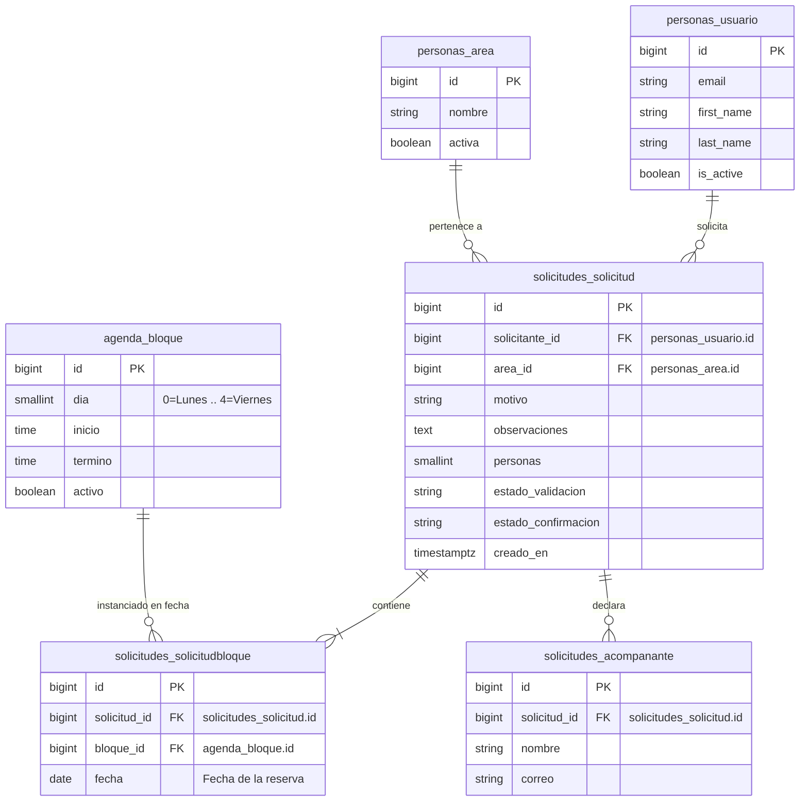

# Diagramas

## Comportamiento

Hay un diagrama de secuencia por escenario de cada historia. Están dibujados
desde el código: cada flecha es una llamada que existe en `main`.

### Cómo leerlos

| Elemento | Qué representa |
|---|---|
| Participante | Una parte del código con el nombre que tiene ahí (`personas.views`, `agenda`, la base) y, debajo, el archivo que la implementa. |
| Color | La capa: azul es presentación, morado es dominio y verde es persistencia. |
| Flecha | Una llamada, escrita como en su línea de código. Hacia la base, solo la operación SQL y la tabla. |
| Flecha a sí mismo | Una línea de código que esa parte ejecuta por dentro. |
| Comentario (`#`, en gris) | Lo que hace la línea de código de abajo, en palabras. Va en las más largas. |
| Barra de activación | La llamada en curso. Toda llamada abre una, también las internas. |
| Retorno (punteado) | La variable donde queda el resultado. Lo que vuelve de la base es `fila` o `filas`. Lo que no devuelve nada, como `save()`, no tiene retorno. |
| Respuesta al actor | El código HTTP y la plantilla o la dirección, como `200 · uso/bloques.html`. |
| `alt`, `opt`, `loop` | Ramas, pasos opcionales y repeticiones, con la condición entre corchetes. Si un retorno decide la rama, cada rama lleva el suyo. |
| `break` | Una salida anticipada, como un `400` o un `404`. |
| Nota | Por qué el código hace ese paso. |

Los argumentos se acortan cuando no cambian lo que pasa, y dentro de un
formulario `self.instance` es el modelo que se le pasó. El control de acceso por
rol (`staff_member_required`, `user_passes_test`) corre antes de cada vista y no
se dibuja.

### Inicio de sesión (US-01)

Las cuatro puertas, `/solicitante/entrar/`, `/configuracion/entrar/`,
`/validacion/entrar/` y `/apoyo/entrar/`, son la misma vista `entrar` con otros
argumentos: cada una dice qué rol deja pasar, a qué panel lleva (`destino`) y
qué título muestra. La plantilla, la autenticación y el bloqueo son los mismos
para todas. `/login/` solo redirige a la del solicitante, para no romper enlaces
viejos. Los diagramas siguen al solicitante, que es el rol de US-01, y van
separados por cómo termina el intento: con la clave correcta, con la clave
incorrecta o con la cuenta bloqueada.

`_puede_pasar` se revisa después de autenticar y antes de `login()`. Sin el rol
de la puerta responde el mismo error que una clave mala, sin abrir sesión y sin
sumar un intento, porque la clave era correcta (AC4).

`django.contrib.auth` busca la cuenta y revisa la clave a través de
`personas`, porque `Usuario` es el modelo de usuario del proyecto.

Cuando la respuesta es 200, htmx reemplaza solo el formulario y conserva el
correo escrito.

La recuperación de clave (AC6) no tiene diagrama propio: son las cuatro vistas
que trae Django (`PasswordReset`, `Done`, `Confirm` y `Complete`), con enlace
firmado y sin tabla nuestra. El proyecto solo pone las plantillas.

### Guardar los parámetros del sistema (US-04)

La bitácora de quién cambió qué es el AC4, y es lo que obliga a que el guardado
sea una transacción: unos parámetros cambiados sin su fila de bitácora son justo
lo que el criterio pide evitar.

El rango se escribe una sola vez, en los validadores del modelo, y lo revisa el
servidor. La vuelta por redirección es para que recargar no reenvíe el
formulario y duplique filas en la bitácora. `changed_data` deja fuera lo que no
cambió, así que guardar sin tocar nada no ensucia el historial.

### Editar la plantilla semanal de bloques (US-04)

Un bloque es un tramo de la semana, no una fecha: el cambio vale para ese día
todas las semanas, y por eso solo se edita en la vista semanal. Agregar,
cambiar, quitar y reponer comparten vista porque las cuatro devuelven la misma
rejilla. Quitar y reponer llegan con su `accion`; agregar y cambiar son el
mismo botón, y los distingue si viene o no el `pk` del bloque. Un alta con un
día fuera de lunes a viernes no llega al formulario: la vista contesta 400.

Cada respuesta es la rejilla completa: htmx reemplaza `#calendario` entero y
Alpine arranca de nuevo sobre el fragmento. Sin htmx el formulario se envía
normal y `_responder` contesta con una redirección a
`/configuracion/bloques/?vista=semana&desde=…`. Ese camino no lleva el aviso ni
el bloque elegido.

Quitar no pide confirmación: desactiva y ofrece deshacer después, que es más
rápido y no se pierde nada.

### Ver los bloques del día (US-14)

Los tickets todavía no existen en la base, así que `services._tickets()` los lee
de un JSON de prueba con fechas relativas a hoy. Es el único punto que sabe de
dónde vienen: cuando existan Solicitud y Ticket se cambia esa función, y ni
`bloques_del_dia()` ni `buscar()` ni las vistas se enteran. Todos los del
personal de apoyo ven todos los bloques (AC7), porque el modelo no tiene a quién
asignarlos.

Las canceladas se listan marcadas en vez de desaparecer (AC5), para que nadie se
quede esperando a alguien que ya avisó. Una fecha mal escrita en la dirección no
es un error: se muestra hoy.

### Check-out de un bloque terminado (US-14)

El botón solo aparece cuando el bloque terminó y no se canceló, y la vista
repite esa revisión. El formulario es US-15; mientras tanto, el envío se simula
y queda en la sesión.

Si registra, la vuelta es por redirección, a la lista del día del bloque.

## Estructura y Modelo de Datos

### Solicitud de reserva y bloques horarios (US-02)

El modelo separa la definición de la **plantilla semanal** recurrente (`agenda_bloque`, administrada en US-04) de la **instancia concreta de reserva** (`solicitudes_solicitudbloque`), vinculando la fecha seleccionada con el bloque horario y la solicitud.

- **Archivo fuente PlantUML**: [`diagramas/us-02/modelo-datos.puml`](diagramas/us-02/modelo-datos.puml).
- **Integridad referencial y claves foráneas**:
  - `solicitudes_solicitud.solicitante_id` → `personas_usuario.id` (`on_delete=PROTECT`): protege el historial de solicitudes y auditoría.
  - `solicitudes_solicitud.area_id` → `personas_area.id` (`on_delete=PROTECT`): garantiza la trazabilidad del área académica requirente.
  - `solicitudes_solicitudbloque.solicitud_id` → `solicitudes_solicitud.id` (`on_delete=CASCADE`): mantiene la consistencia de bloques asignados a la solicitud.
  - `solicitudes_solicitudbloque.bloque_id` → `agenda_bloque.id` (`on_delete=PROTECT`): permite desactivar bloques de la plantilla sin alterar las solicitudes históricas ya existentes.
  - **Restricción de unicidad**: `UniqueConstraint(fields=["solicitud", "bloque", "fecha"])` previene asignar duplicados de un mismo bloque horario en la misma fecha para una solicitud.

