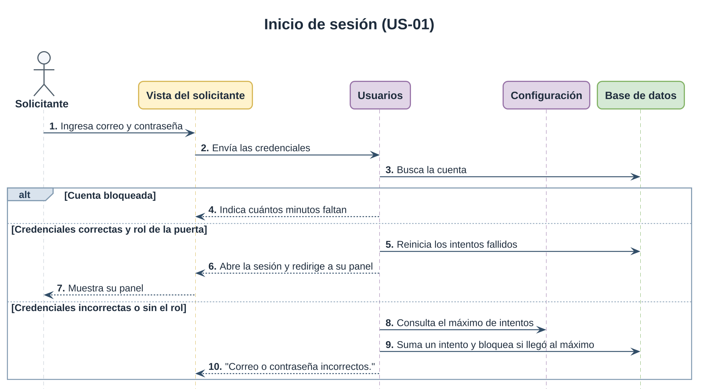
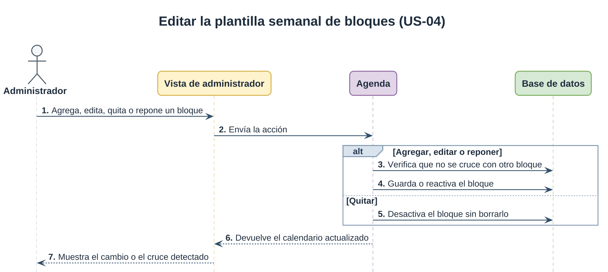
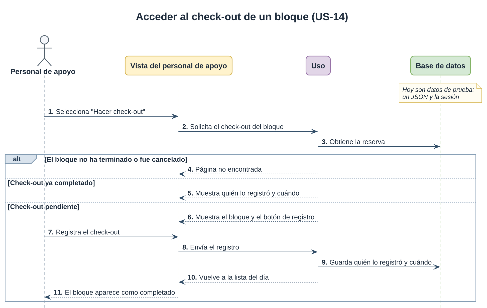

# Diagramas

## Comportamiento

### Inicio de sesión (US-01)

Las tres puertas, `/login/`, `/configuracion/entrar/` y `/apoyo/entrar/`, son la
misma vista `entrar` con otros argumentos: cambia la plantilla y a quién se deja
pasar, no la autenticación ni el bloqueo. El mismo mensaje sale para una clave
mala, un correo que no existe y alguien sin el rol de esa puerta, para que
ninguna sirva de oráculo (AC4).

El diagrama sigue al solicitante, que es el rol de US-01. El administrador y el
personal de apoyo hacen el mismo recorrido por su propia puerta y su propia vista.

Cuando la respuesta es 200, htmx reemplaza solo el formulario y conserva el
correo escrito. Los umbrales se leen de Configuración en cada fallo y no al
arrancar, por eso cambiarlos en el panel rige sin redesplegar. El
bloqueo es temporal para que nadie pueda dejar a otra persona fuera a propósito.

La recuperación de clave (AC6) no tiene diagrama propio: son las cuatro vistas
que trae Django (`PasswordReset`, `Done`, `Confirm` y `Complete`), con enlace
firmado y sin tabla nuestra. El proyecto solo pone las plantillas.

### Guardar los parámetros del sistema (US-04)

La bitácora de quién cambió qué es el AC4, y es lo que obliga a que el guardado
sea una transacción: unos parámetros cambiados sin su fila de bitácora son justo
lo que el criterio pide evitar.

El rango se escribe una sola vez, en los validadores del modelo; los `min` y
`max` del HTML salen de ahí, pero manda el servidor. La vuelta por redirección
es para que recargar no reenvíe el formulario y duplique filas en la bitácora.
`changed_data` deja fuera lo que no cambió, así que guardar sin tocar nada no
ensucia el historial.

### Editar la plantilla semanal de bloques (US-04)

Un bloque es un tramo de la semana, no una fecha: el cambio vale para ese día
todas las semanas, y por eso solo se edita en la vista semanal. Las cuatro
acciones comparten vista porque las cuatro devuelven la misma rejilla. Agregar
y guardar son el mismo botón; los distingue si viene o no el `pk` del bloque.

Quitar no pide confirmación: desactiva y ofrece deshacer después, que es más
rápido y no se pierde nada. Un bloque nunca se borra, para que las solicitudes
que lo apuntan sigan resolviendo. Reponer vuelve a validar porque mientras el bloque
estuvo fuera alguien pudo ocupar esa hora.

Cada respuesta es la rejilla completa: htmx reemplaza `#calendario` entero y
Alpine arranca de nuevo sobre el fragmento. Sin htmx el formulario se envía
normal y `_responder` contesta con una redirección a
`/configuracion/bloques/?vista=semana&desde=…`, para que recargar no reenvíe el
POST. Ese camino no lleva el aviso ni el bloque elegido.

### Ver los bloques del día (US-14)

Los tickets todavía no existen en la base, así que `services.bloques_del_dia()`
los lee de un JSON de prueba con fechas relativas a hoy. Es el único punto que
sabe de dónde vienen: cuando existan Solicitud y Ticket se cambia esa función y
la vista no se entera. Todos los del personal de apoyo ven todos los bloques
(AC7), porque el modelo no tiene a quién asignarlos.

Las canceladas se listan marcadas en vez de desaparecer (AC5), para que nadie se
quede esperando a alguien que ya avisó. Una fecha mal escrita en la dirección no
es un error: se muestra hoy.

### Entrar al check-out de un bloque terminado (US-14)

El botón solo aparece cuando el bloque terminó y no se canceló, y la vista
repite esa revisión: escribir la dirección a mano da 404, igual que para un
ticket pendiente o inexistente. El formulario es US-15; mientras tanto, el envío
se simula y queda en la sesión.

El POST vuelve a buscar el ticket antes de registrar, así que un bloque
completado no se registra dos veces aunque se reenvíe el formulario (US-15 AC4).
La vuelta es por redirección, a la lista del día del bloque.
