# Diagramas

## Comportamiento

Hay un diagrama de secuencia por escenario de cada historia. Están dibujados
desde el código: cada flecha es una llamada que existe en `main`.

### Cómo leerlos

| Elemento | Qué representa |
|---|---|
| Participante | Una parte del código con el nombre que tiene ahí (`personas.views`, `agenda`, la base) y, debajo, el archivo que la implementa. |
| Color | La capa: azul es presentación, morado es dominio y verde es persistencia. |
| Flecha | Una llamada, escrita como en su línea de código. Hacia la base, solo la operación SQL y la tabla. |
| Flecha a sí mismo | Una línea de código que esa parte ejecuta por dentro. |
| Comentario (`#`, en gris) | Lo que hace la línea de código de abajo, en palabras. Va en las más largas. |
| Barra de activación | La llamada en curso. Toda llamada abre una, también las internas. |
| Retorno (punteado) | La variable donde queda el resultado. Lo que vuelve de la base es `fila` o `filas`. Lo que no devuelve nada, como `save()`, no tiene retorno. |
| Respuesta al actor | El código HTTP y la plantilla o la dirección, como `200 · uso/bloques.html`. |
| `alt`, `opt`, `loop` | Ramas, pasos opcionales y repeticiones, con la condición entre corchetes. Si un retorno decide la rama, cada rama lleva el suyo. |
| `break` | Una salida anticipada, como un `400` o un `404`. |
| Nota | Por qué el código hace ese paso. |

Los argumentos se acortan cuando no cambian lo que pasa, y dentro de un
formulario `self.instance` es el modelo que se le pasó. El control de acceso por
rol (`staff_member_required`, `user_passes_test`) corre antes de cada vista y no
se dibuja.

### Inicio de sesión (US-01)

Las cuatro puertas, `/solicitante/entrar/`, `/configuracion/entrar/`,
`/validacion/entrar/` y `/apoyo/entrar/`, son la misma vista `entrar` con otros
argumentos: cada una dice qué rol deja pasar, a qué panel lleva (`destino`) y
qué título muestra. La plantilla, la autenticación y el bloqueo son los mismos
para todas. `/login/` solo redirige a la del solicitante, para no romper enlaces
viejos. Los diagramas siguen al solicitante, que es el rol de US-01, y van
separados por cómo termina el intento: con la clave correcta, con la clave
incorrecta o con la cuenta bloqueada.

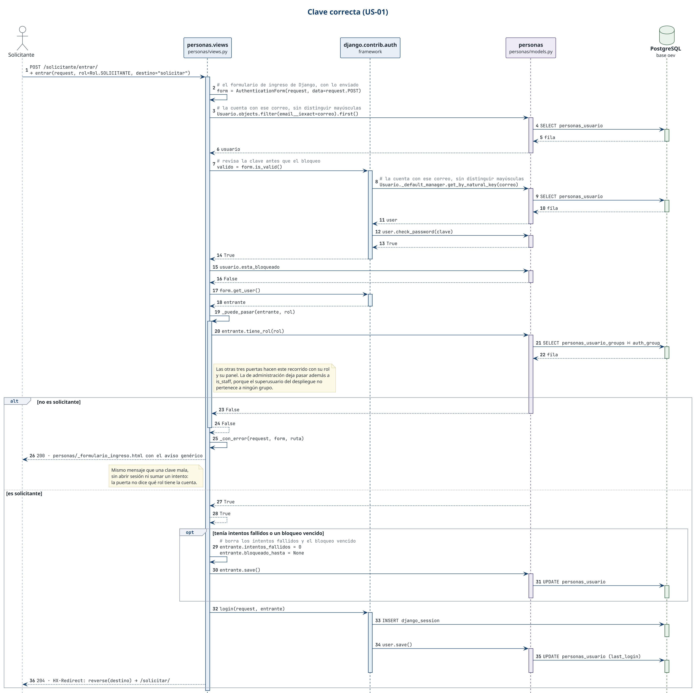

`_puede_pasar` se revisa después de autenticar y antes de `login()`. Sin el rol
de la puerta responde el mismo error que una clave mala, sin abrir sesión y sin
sumar un intento, porque la clave era correcta (AC4).

`django.contrib.auth` busca la cuenta y revisa la clave a través de
`personas`, porque `Usuario` es el modelo de usuario del proyecto. La busca sin
distinguir mayúsculas (`get_by_natural_key`), igual que la vista que cuenta los
intentos: así un correo escrito con otras mayúsculas no suma fallos.

Si el ingreso lo pidió otra página, como el enlace de confirmación del correo de
aceptación (US-03), la puerta vuelve a ella (`next`) y no al panel del rol.
Solo si la dirección es de este sitio: `url_has_allowed_host_and_scheme`
descarta cualquier otra, así el formulario no sirve para mandar a alguien recién
autenticado a una página ajena.

Con la cuenta bloqueada la clave se revisa igual y la respuesta es el mismo
aviso que una clave mala: ni el texto ni la demora dicen que la cuenta existe.

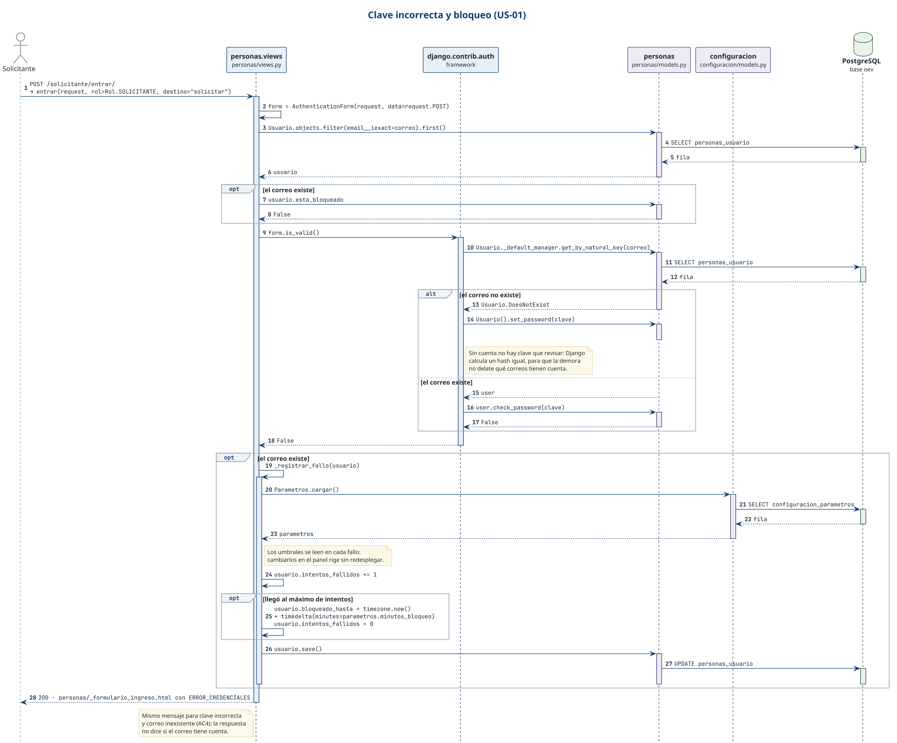

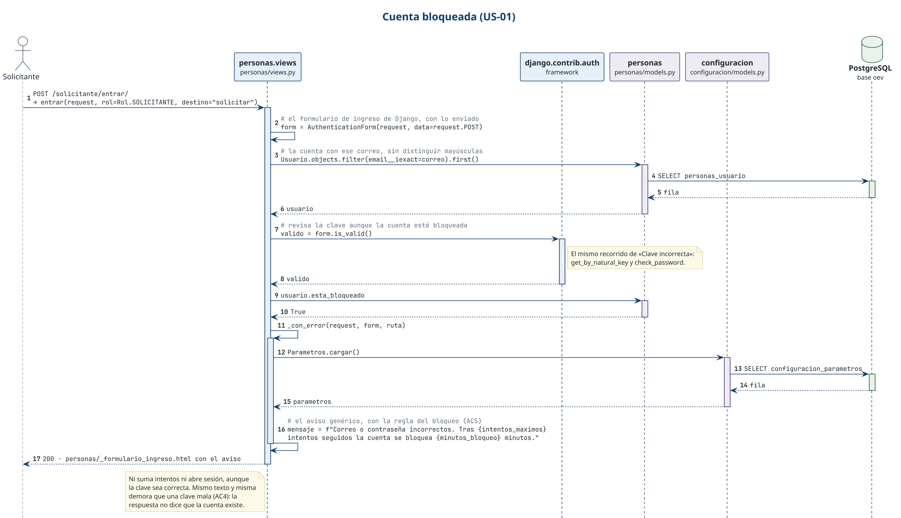

Cuando la respuesta es 200, htmx reemplaza solo el formulario y conserva el
correo escrito.

La recuperación de clave (AC6) no tiene diagrama propio: son las cuatro vistas
que trae Django (`PasswordReset`, `Done`, `Confirm` y `Complete`), con enlace
firmado y sin tabla nuestra. El proyecto solo pone las plantillas.

### Ir al panel desde la raíz (US-08)

Al entrar, cada puerta lleva a su `destino`. La raíz `/` es para quien ya tiene
sesión y vuelve al sitio. Como los roles son grupos de Django y una persona
puede tener varios (AC6), `destino_tras_login` los pregunta en orden de
prioridad, administración, validación y personal de apoyo, y manda al panel del
primero que tiene. Sin ninguno va al formulario de reserva, que es el panel del
solicitante (US-01 AC3). `is_staff` cuenta como administrador sin consultar la
base, porque el superusuario que crea el despliegue no pertenece a ningún grupo.

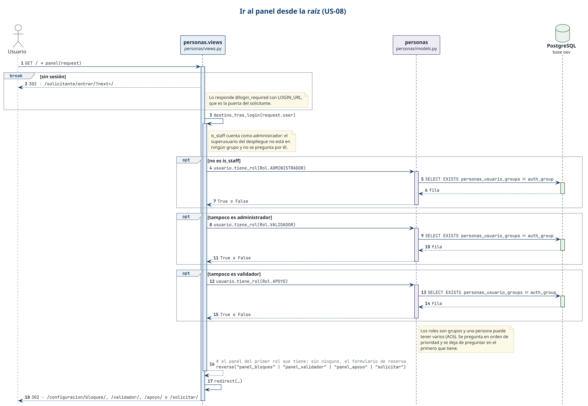

Cada `tiene_rol` es una consulta, y se deja de preguntar en el primer rol que la
persona tiene. Sin sesión, `login_required` manda a la puerta del solicitante con
`?next=/`. Cerrar sesión no tiene diagrama: es `LogoutView` de Django, que
vuelve a esa misma puerta.

### Elegir el área académica (US-02)

La solicitud siempre queda vinculada a un área, así que es lo primero que se
resuelve. Sin áreas activas no hay formulario; con una sola, el asistente la
fija solo y sigue al paso 1; con varias, pasa por `/solicitar/area/`. El área
queda en la sesión, como todo lo que se elige antes de enviar.

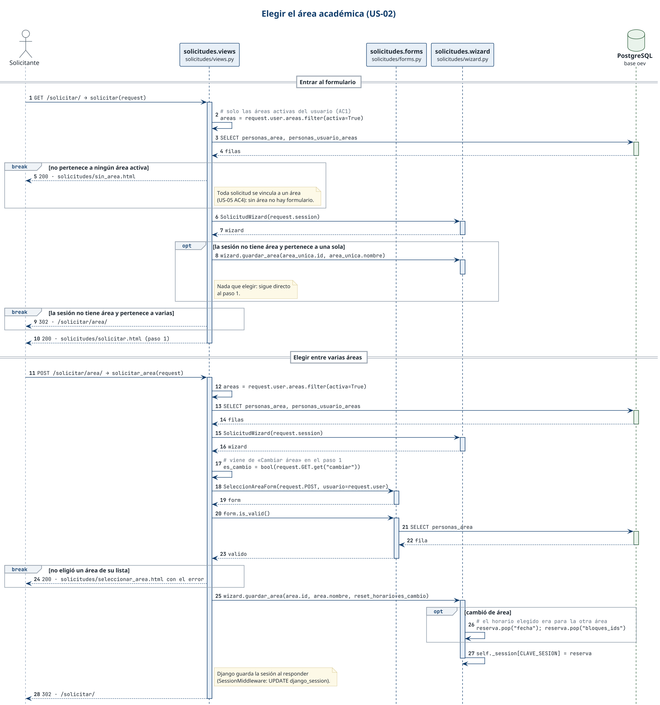

Cambiar de área desde el paso 1 (`?cambiar=1`) borra el día y los bloques ya
elegidos, porque se habían elegido para la otra.

### Elegir el día y los bloques (US-02)

Todos los pasos del asistente parten igual: `solicitar` lee las áreas activas
del usuario y `SolicitudWizard.ajustar_area` fija la única que tenga, o lo
manda a elegir si tiene varias y falta o dejó de estar activa. Después
`validar_acceso` decide el paso: si la sesión no completó los anteriores, se
atiende el primero que falta.

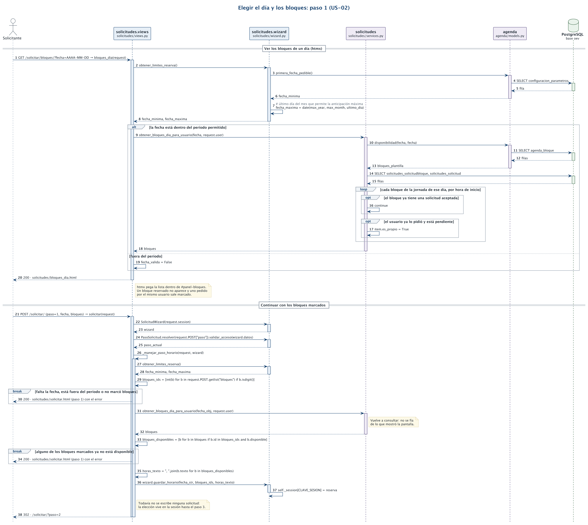

La fecha y los bloques los valida `SeleccionHorarioForm`, que es la misma regla
del calendario público: la fecha, con formato y dentro de los límites de
reserva, y los bloques, que sigan libres para ese usuario. Un bloque que el
usuario ya tiene pendiente se rechaza aquí, igual que la pantalla lo
deshabilita. Si todo es válido queda en la sesión y se pasa al paso 2; si no,
vuelve el calendario con el error y lo que ya tenía elegido.

### Ver los bloques de un día (US-02)

Elegir un día no envía el paso 1. Cada día pedible del calendario es un enlace
con `hx-get` a `/solicitar/bloques/`, que devuelve solo la lista de bloques, y
htmx la pone en el panel. La fecha pasa por `FechaReservaForm.fecha_de`, la
misma regla del paso 1: una fecha escrita a mano fuera del período no muestra
bloques. La lista sale de `obtener_bloques_dia_para_usuario`, igual que en la
validación del paso 1: sin lo bloqueado (US-17) ni lo ya aceptado, y con lo que
el usuario ya pidió marcado y sin poder elegirse.

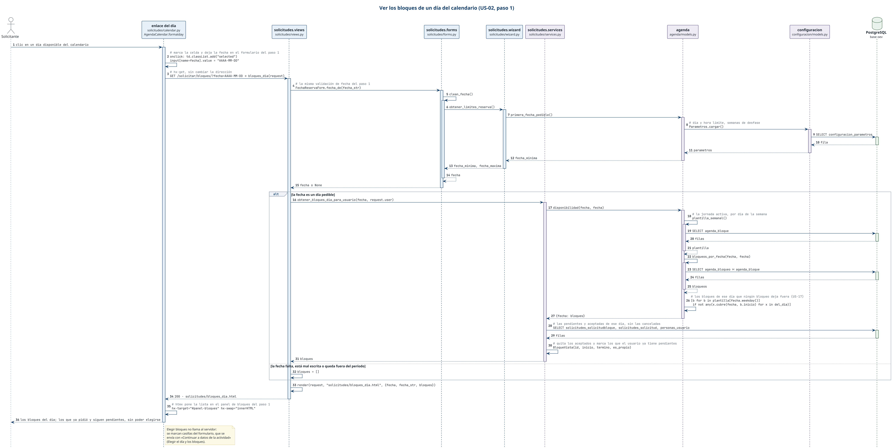

### Cambiar de mes en el calendario (US-02)

Las flechas y el selector de mes y año piden `/solicitar/calendario/` con htmx.
Esa vista responde la página del calendario (`calendario.html`) y htmx toma de
ella solo el componente (`hx-select="#calendario-componente"`).
`construir_calendario_contexto` lleva el mes pedido a los límites de reserva y
marca qué días tienen algún bloque libre (`obtener_dias_con_disponibilidad`).

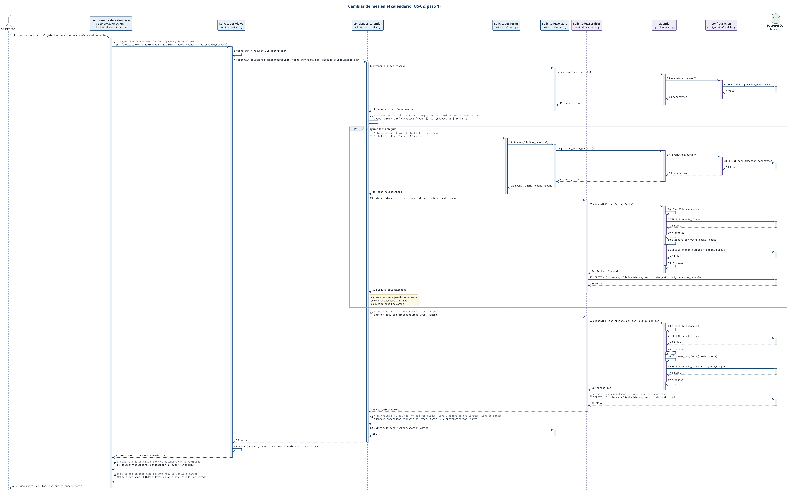

La petición incluye la fecha ya elegida (`hx-include`), para que el día siga
marcado en el mes nuevo. Con esa fecha la vista también calcula sus bloques, que
van en la respuesta pero quedan fuera de lo que htmx toma: la lista del paso 1 no
cambia. El `POST` de esa vista, con su propio botón de confirmar, no tiene
diagrama: no es parte del asistente y solo se alcanza sin JavaScript, desde el
selector rápido.

### Completar los datos de la actividad (US-02)

`SolicitudForm` se usa sin el campo de términos (`exigir_terminos=False`),
porque se aceptan en el paso 3. La cantidad de personas y las filas de
acompañante están en formularios distintos, así que la regla que las cruza
(AC6) vive en `services.revisar_acompanantes`.

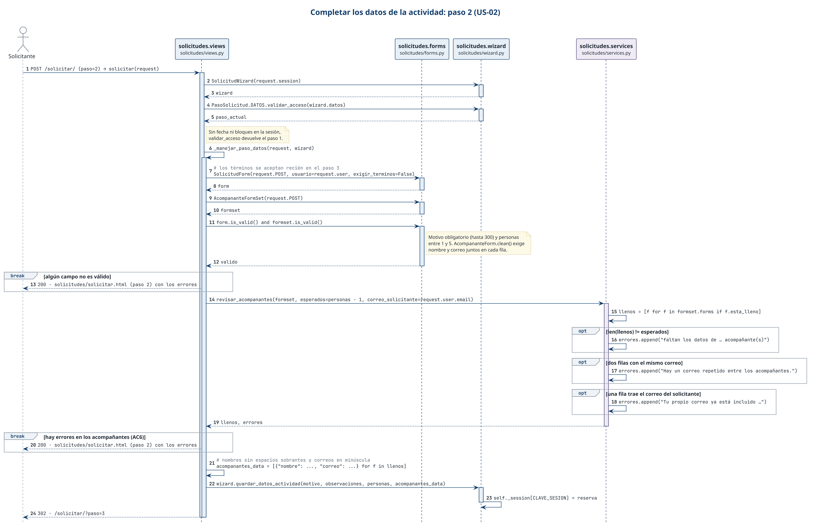

### Enviar una solicitud de reserva (US-02)

El envío es el paso 3 del asistente y exige aceptar los términos y condiciones
(AC10). El guardado es una transacción atómica dentro de
`guardar_solicitud_completa`: la `Solicitud` con la fecha elegida y la validación
pendiente (AC5), un `SolicitudBloque` por bloque y los acompañantes declarados
(AC6). Si un bloque está inactivo, ya tomado o ya pedido, la transacción se
deshace entera y la vista vuelve a mostrar el paso 3 con el error.

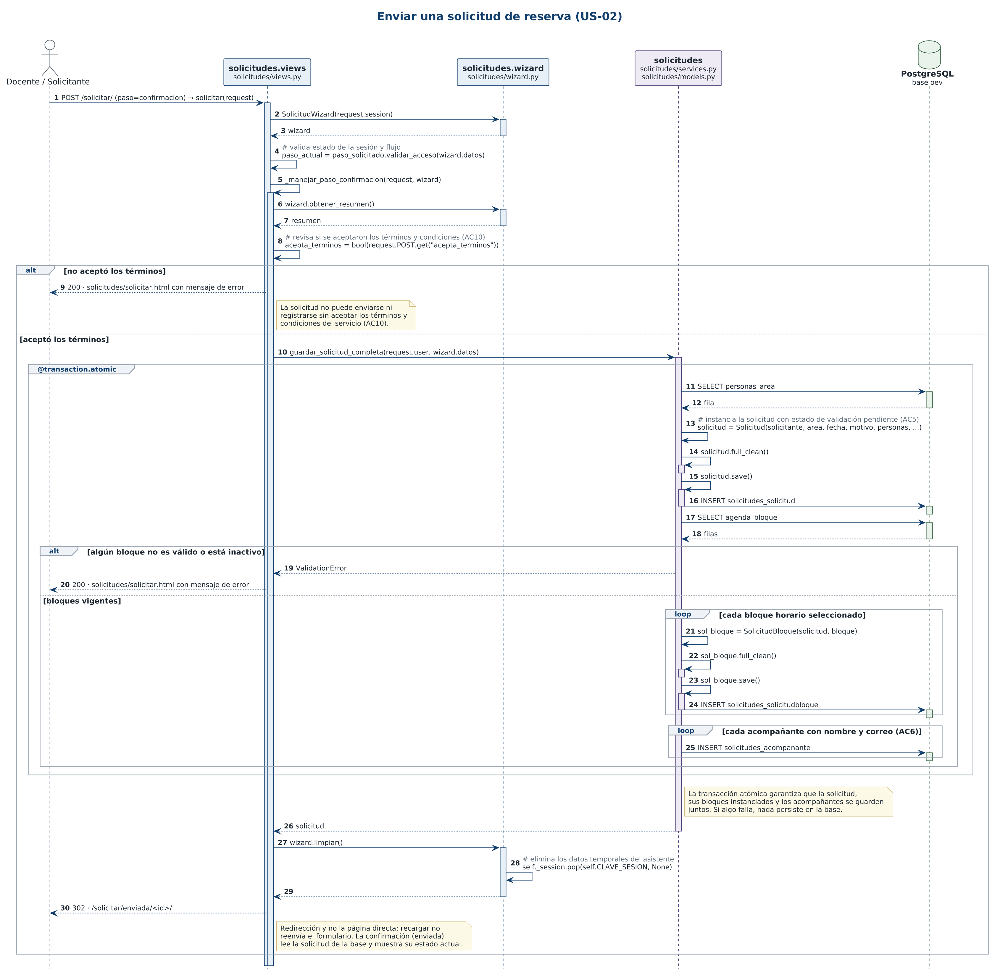

Al guardar se limpia la sesión del asistente y se redirige a
`/solicitar/enviada/<id>/`: recargar no reenvía el formulario. La confirmación
lee la solicitud de la base, solo si es del usuario, y muestra su estado actual.
`SolicitudBloque.save()` vuelve a llamar a `clean()` después de `full_clean()`,
así que las consultas de validación de cada bloque se hacen dos veces.

### Abrir el panel del validador (US-07)

El panel es la Jornada semanal de Configuración con quién pide cada bloque
adentro. `validacion.cargar()` lee, con un número fijo de consultas, lo que esa
agenda dibuja: las pendientes desde hoy que tienen bloques, las ya aceptadas de
esas semanas, lo resuelto hoy por cualquier validador (AC5), la jornada con los
bloques quitados y los bloqueos (US-17). Devuelve la forma que espera la
plantilla, que no sabe de modelos. La pestaña Validación del administrador es la
misma vista con otro envoltorio: `panel_validacion_admin` incluye
`_validacion.html` dentro de `panel.html`.

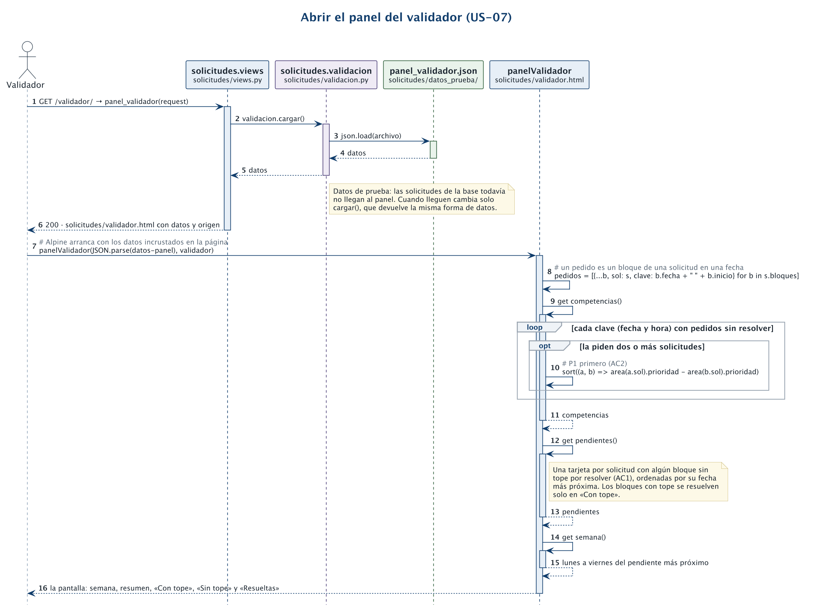

El resto ocurre en el navegador. `panelValidador`, el componente de Alpine de
`_validacion.html`, arma cada día de la semana con sus bloques y, en cada uno,
las solicitudes que lo piden, ordenadas por prioridad del área (AC2). Un bloque
quitado de la jornada se dibuja solo si esa fecha todavía tiene algo.

### Resolver una solicitud con tope (US-07)

Se aprueba o se rechaza la solicitud entera. Aprobar una que choca con otras
las rechaza enteras con el mismo motivo, por eso el motivo es obligatorio: es
lo que les llega a quienes pierden (AC4). `resolver()` bloquea la solicitud y
sus rivales en orden de id, así dos validadores que deciden el mismo bloque a
la vez quedan en fila y el segundo ve lo que hizo el primero (AC3). Cada
resolución queda con `resuelta_por`, `resuelta_en` y `motivo_resolucion` (AC5),
y el correo sale solo cuando la transacción se confirma.

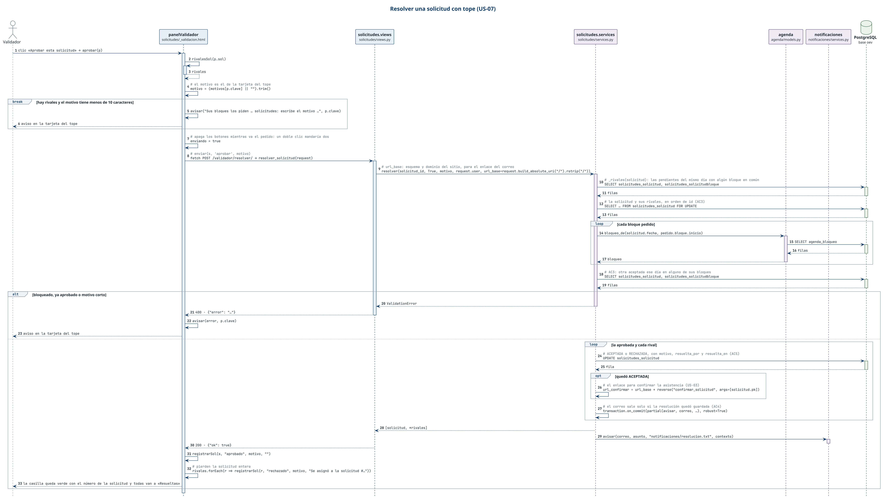

La pantalla cambia solo si el servidor respondió `{"ok": true}`. Si la sesión
venció, la respuesta es la página de ingreso y no JSON, y el panel avisa que no
se pudo guardar. Mientras va el pedido los botones se apagan (`enviando`): un
doble clic mandaría dos, y el segundo respondería que ya fue resuelta aunque se
guardó.

El correo de una aprobada trae el enlace para confirmar la asistencia (US-03).
La vista le pasa a `resolver()` el esquema y el dominio del sitio (`url_base`)
para armar el enlace completo; sin ellos, el correo sale sin enlace.

### Resolver una solicitud sin tope (US-07)

Sin rivales, aprobar no pide motivo. Rechazar sí, y se confirma en la misma
ficha, donde sale también el aviso si falta. Si otro validador ya la resolvió o
el solicitante la retiró, el servidor lo dice y el panel lo muestra. Lo que la
pantalla revisa antes de enviar (motivo, bloqueo, bloque quitado) es para avisar
rápido: el servidor lo vuelve a revisar.

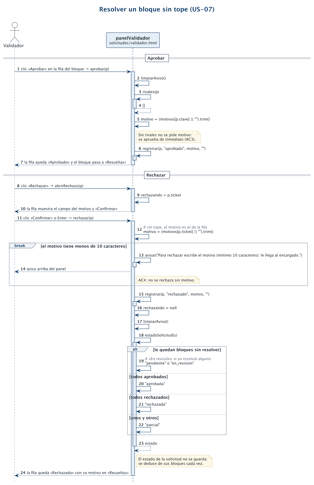

### Guardar los parámetros del sistema (US-04)

La bitácora de quién cambió qué es el AC4, y es lo que obliga a que el guardado
sea una transacción: unos parámetros cambiados sin su fila de bitácora son justo
lo que el criterio pide evitar.

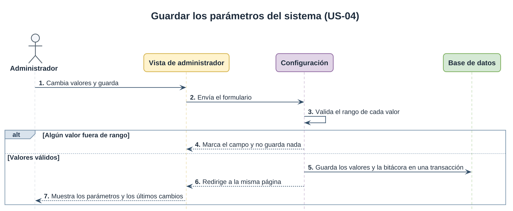

El rango se escribe una sola vez, en los validadores del modelo, y lo revisa el
servidor. La vuelta por redirección es para que recargar no reenvíe el
formulario y duplique filas en la bitácora. `changed_data` deja fuera lo que no
cambió, así que guardar sin tocar nada no ensucia el historial.

### Ver los parámetros y los últimos cambios (US-04)

Es la vuelta de Guardar: la pestaña Reglas con los valores vigentes y los últimos
15 cambios de la bitácora, con quién los hizo (AC4). El historial completo está
en la administración de Django; aquí basta con lo último, que es como se nota un
cambio ajeno. `Parametros.cargar()` es el único punto de entrada a la fila y la
crea con los valores del cliente si todavía no existe (AC2).

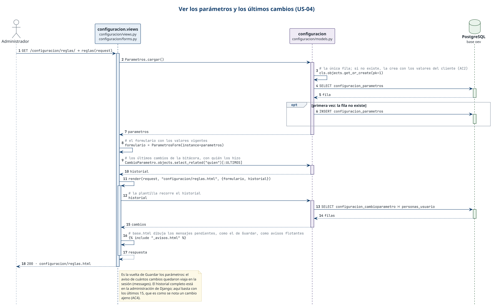

Cuántos cambios quedaron, o que no había nada que cambiar, llega como mensaje
de Django en la sesión, y `base.html` lo dibuja como aviso flotante.

### Editar la plantilla semanal de bloques (US-04)

Un bloque es un tramo de la semana, no una fecha: el cambio vale para ese día
todas las semanas, y por eso solo se edita en la vista semanal. Agregar,
cambiar, quitar y reponer comparten vista porque las cuatro devuelven la misma
rejilla. Quitar y reponer llegan con su `accion`; agregar y cambiar son el
mismo botón, y los distingue si viene o no el `pk` del bloque. Un alta con un
día fuera de lunes a viernes no llega al formulario: la vista contesta 400.

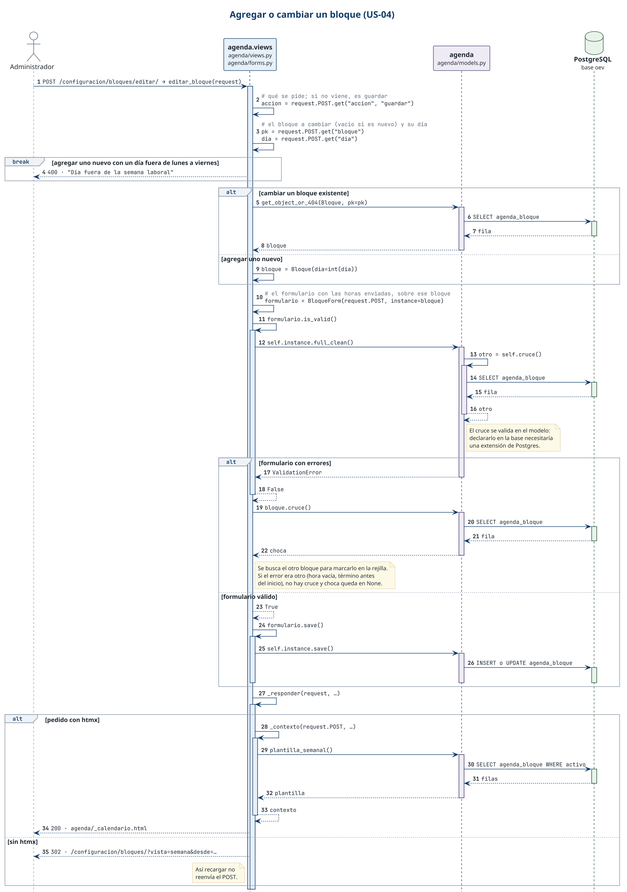

Cada respuesta es la rejilla completa: htmx reemplaza `#calendario` entero y
Alpine arranca de nuevo sobre el fragmento. Sin htmx el formulario se envía
normal y `_responder` contesta con una redirección a
`/configuracion/bloques/?vista=semana&desde=…`. Ese camino no lleva el bloque
elegido, y el error, que con htmx va dentro del pop-up, llega como aviso
flotante.

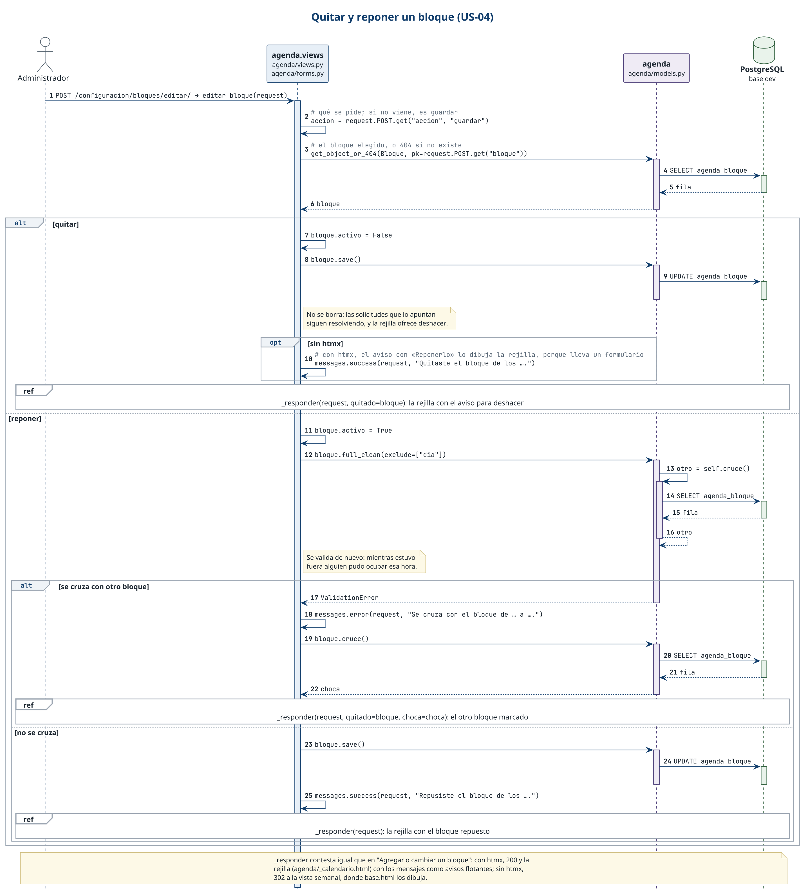

Quitar no pide confirmación: desactiva y ofrece deshacer después, que es más
rápido y no se pierde nada.

### Ver la jornada en la vista mensual (US-04)

Es la vista con que abre el panel del administrador: la mensual es la de por
defecto, a pedido del cliente. Sirve para revisar, no para editar. Como la
jornada es la misma todas las semanas, se resume una vez por columna: cuántos
bloques y horas tiene ese día de la semana, y si se sale del molde. Las celdas
muestran lo que cambia por fecha, que son los bloqueos (US-17), y al pie va el
registro de los últimos bloqueos y levantamientos (US-17 AC6).

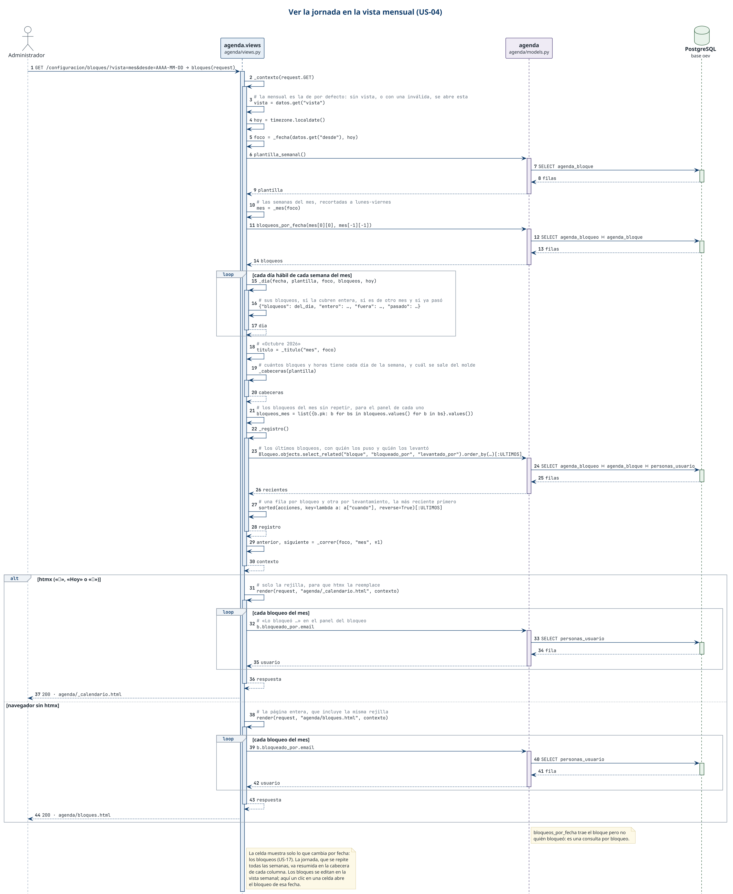

El panel de cada bloqueo dice quién lo puso, y `bloqueos_por_fecha` trae el
bloque pero no a esa persona: la plantilla hace una consulta por cada bloqueo
del mes. La pestaña Áreas no tiene diagrama: hoy es un marcador que solo dibuja
la plantilla, y su contenido llega con US-05.

### Ver mis solicitudes (US-09)

El historial lista todas las solicitudes del usuario, de cualquiera de sus
áreas, con el área, la fecha, los bloques y el estado. Se separa en Próximas y
Anteriores por día calendario: una solicitud es próxima si su fecha es hoy o
posterior, aunque la hora de sus bloques ya haya pasado. Esas reglas
viven en `SolicitudQuerySet` (`de`, `proximas`, `anteriores`, `con_detalle`) y
no en la vista, porque son del dominio: la vista solo elige la pestaña, pagina y
responde. La fecha es un campo de la solicitud, así que filtrar y ordenar no
toca los bloques.

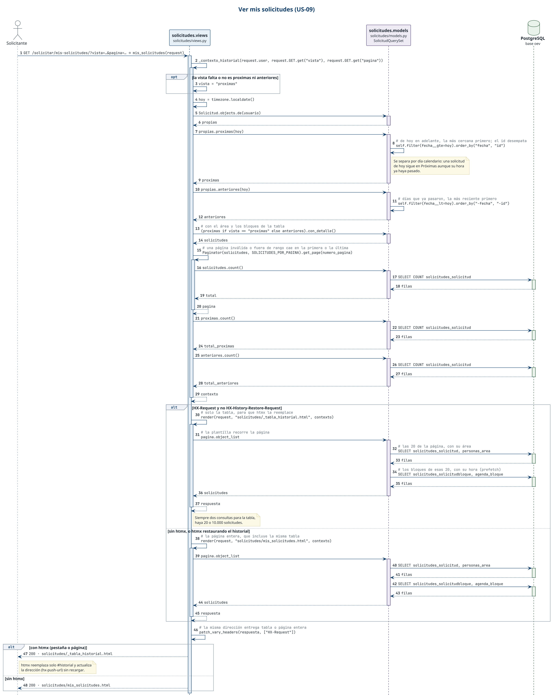

La página trae 20 solicitudes y siempre hace las mismas consultas: tres
`COUNT` (el paginador y las dos pestañas), la página con su área y los bloques
de esa página. Cambiar de pestaña o de página es el mismo `GET` con htmx, que
recibe solo `_tabla_historial.html` y actualiza la dirección. Si htmx restaura
el historial sin tenerlo en caché, pide la página entera, y `Vary: HX-Request`
evita que el navegador confunda una respuesta con la otra.

### Retirar una solicitud propia (US-09)

Solo se retira una solicitud que la Oficina todavía no revisa. Pasa a
`RETIRADA`, un estado más de la validación, y no se borra: sigue en el historial.
`CANCELADA` queda para el flujo de confirmación. La disponibilidad y la regla de
bloque ya pedido cuentan solo las pendientes y aceptadas, así que el bloque
retirado queda libre sin tocarlas.

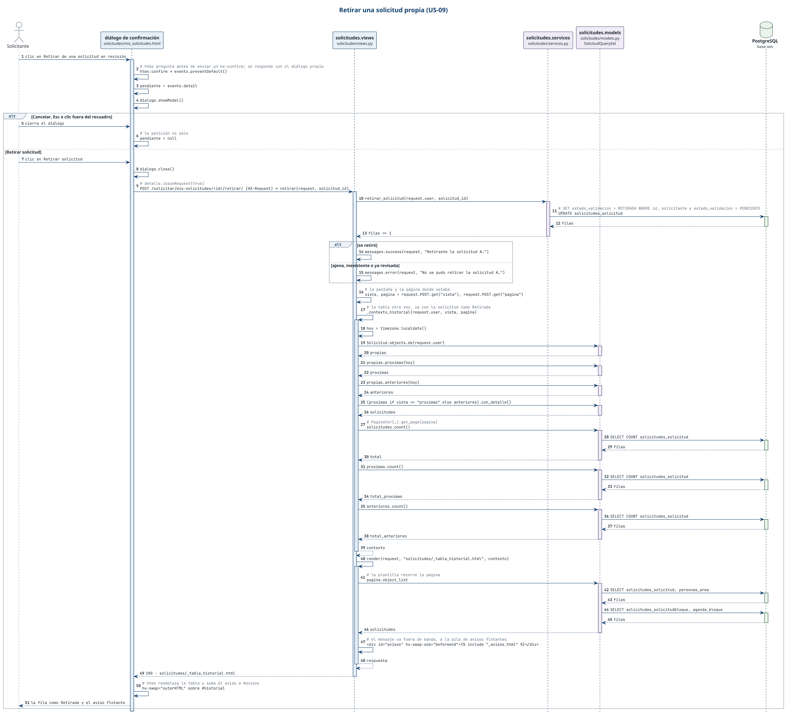

La confirmación es un `<dialog>` propio: el script intercepta `htmx:confirm` y
la petición sale solo si se confirma. El retiro es un único `UPDATE`
condicionado a que la solicitud siga pendiente y sea del usuario, para no pisar
al validador si decide en el mismo instante. Si no aplica, el mensaje es el
mismo sea ajena, inexistente o ya revisada. Con htmx vuelve la tabla en la misma
pestaña y página, y el mensaje llega fuera de banda como aviso flotante. Sin
htmx, la vuelta es por redirección al historial.

### Confirmar la asistencia (US-03)

El correo de una solicitud aceptada trae un enlace a
`/solicitar/mis-solicitudes/<id>/confirmar/`, el mismo de **Confirmar
asistencia** en Mis solicitudes. Abrirlo solo muestra la reserva; confirma el
botón, con un `POST`, para que un lector de correo que abre los enlaces no
confirme por su cuenta. Sin sesión, la puerta del solicitante vuelve al enlace
después de entrar (`next`, ver Clave correcta).

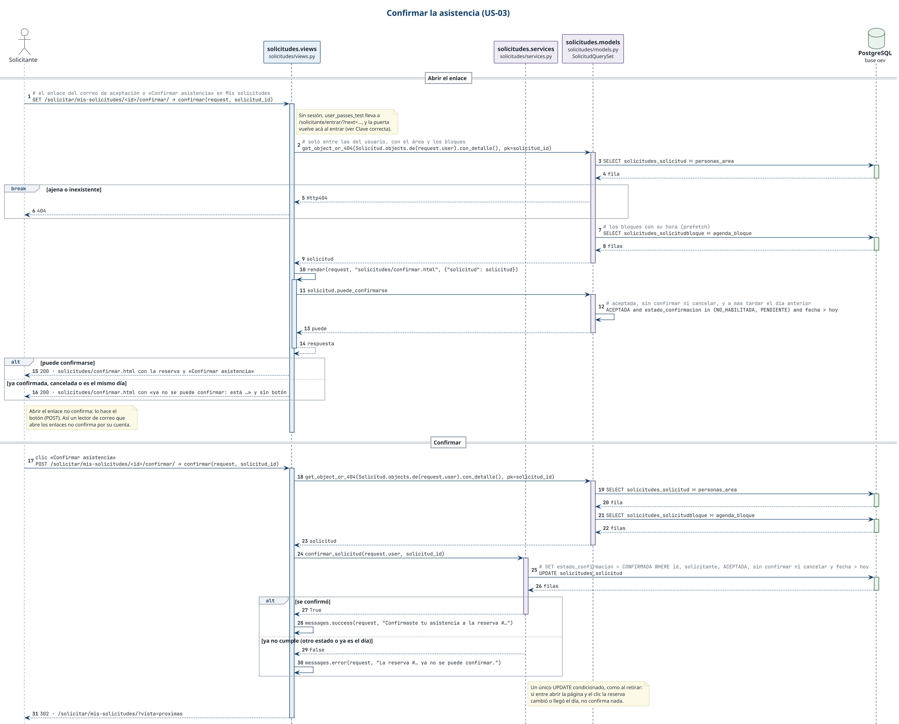

Se confirma hasta el día anterior, y solo una aceptada que no esté confirmada ni
cancelada. La regla está dos veces: `Solicitud.puede_confirmarse` decide si la
página muestra el botón, y el `UPDATE` condicionado de `confirmar_solicitud` es
el que vale, como al retirar. Si entre abrir la página y el clic la reserva
cambió o llegó el día, no se confirma y vuelve a Mis solicitudes con el aviso.

### Recordar la confirmación (US-03)

El servidor no tiene cron, así que el stack suma el servicio `tareas`: la misma
imagen que `web`, con un bucle que corre `recordar_confirmaciones` cada hora. El
comando avisa a cada reserva aceptada que entró al plazo de confirmación
(`plazo_confirmacion_dias`) sin confirmar, cancelar ni recordatorio previo. La
marca es el paso a `PENDIENTE` con `recordatorio_enviado_en`, y va después del
correo: si el envío falla, la vuelta siguiente lo reintenta, y correrlo dos
veces no repite avisos.

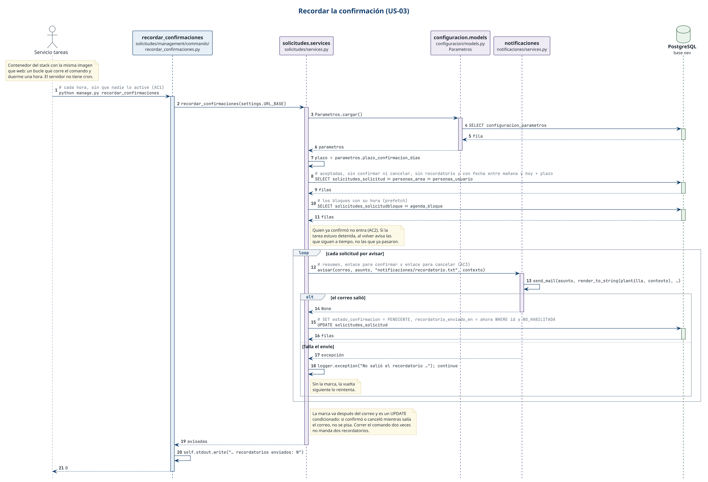

Una aceptada que llega a su día sin confirmar no cambia de fila: `estado_clave`
la calcula como **no confirmada** por la fecha, y el personal de apoyo la ve sin
check-out pendiente.

### Cancelar la reserva (US-03)

`/solicitar/mis-solicitudes/<id>/cancelar/` es el enlace del recordatorio y de
**Cancelar reserva** en Mis solicitudes. Como al confirmar, el `GET` solo
muestra la reserva y es la segunda confirmación; cancela el `POST`. Se puede
cancelar una aceptada, confirmada o no, hasta que empiece su primer bloque.

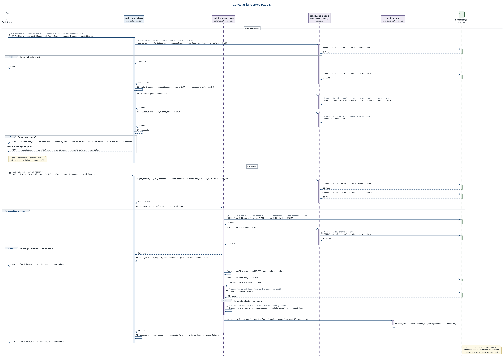

La regla del primer bloque no cabe en un `UPDATE` condicionado, así que
`cancelar_solicitud` bloquea la fila (`select_for_update`) y la revisa: si en
otra pestaña confirma al mismo tiempo, una espera a la otra. Desde el lunes de
la semana de la reserva, cancelar cuenta como inasistencia
(`cancelar_cuenta_inasistencia`, calculado con `cancelada_en`). El correo a
quien la aprobó sale solo si la cancelación quedó guardada.

### Ver los bloques del día (US-14)

Cada ticket es un bloque de una solicitud aceptada en una fecha
(`SolicitudBloque`), y `services._tickets()` es el único punto que lo consulta.
Las pendientes no se listan (AC4): todavía pueden rechazarse. Todos los del
personal de apoyo ven todos los bloques (AC7), porque el modelo no tiene a quién
asignarlos.

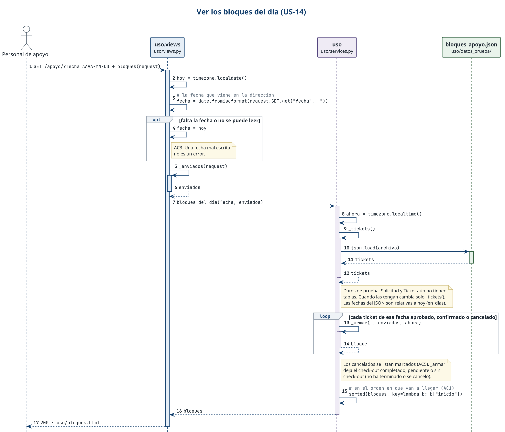

Las canceladas se listan marcadas en vez de desaparecer (AC5), para que nadie se
quede esperando a alguien que ya avisó. Una fecha mal escrita en la dirección no
es un error: se muestra hoy.

### Check-out de un bloque terminado (US-14)

El botón solo aparece cuando el bloque terminó y no se canceló, y la vista
repite esa revisión. El formulario es US-15; mientras tanto, el envío se simula
y queda en la sesión.

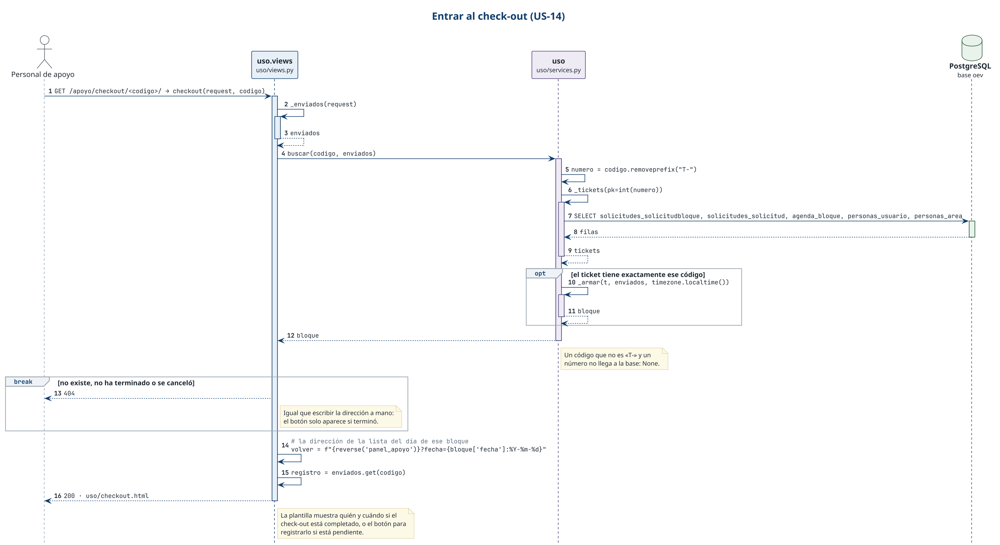

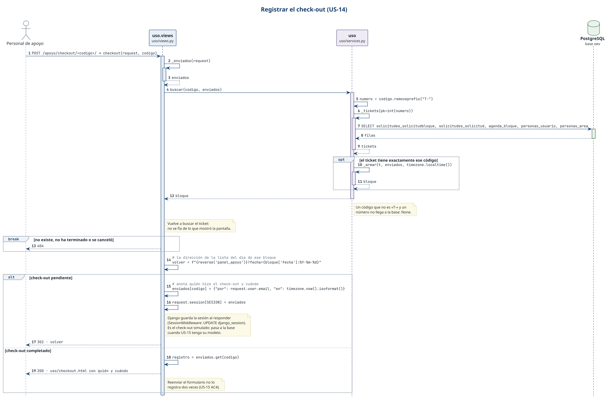

Si registra, la vuelta es por redirección, a la lista del día del bloque.

### Completar el checklist de cierre de la sala (US-15)

Este diagrama es la excepción a la regla de arriba: dibuja el prototipo de la
rama `feat/us-15-checkout-de-constancia`, que todavía no está en `main`. Ahí,
`/checklist/` solo entrega la plantilla y todo lo demás corre en
`static/js/checklist.js`: cuatro pasos de preguntas Sí o No, y un No exige una
observación de al menos 10 caracteres y una foto de integridad. El último paso
pide además la hora efectiva de salida.

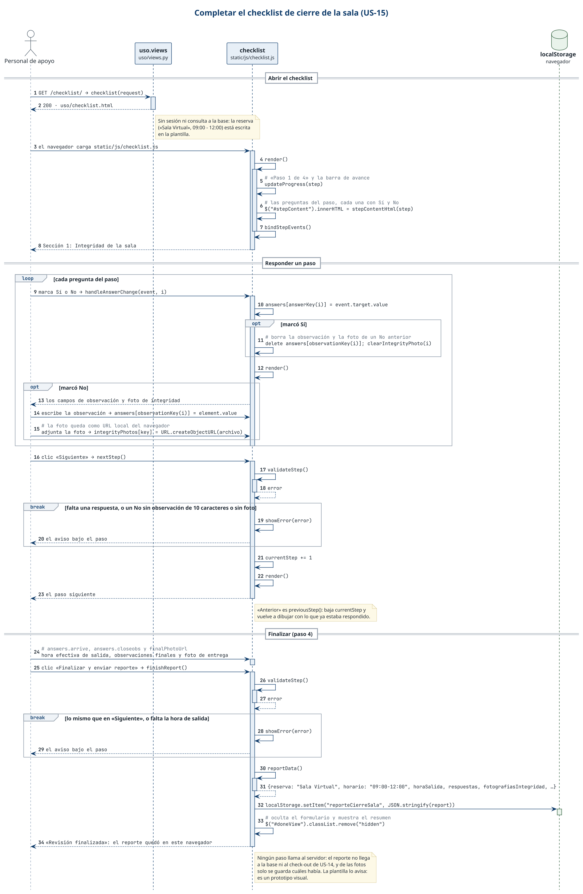

Ningún paso llama al servidor. La reserva está escrita en la plantilla, el
reporte queda en el `localStorage` del navegador y de las fotos solo se guarda
cuáles había. Todavía no reemplaza el check-out simulado de US-14: cuando se
integre con él, este diagrama se tiene que rehacer.

### Bloquear la sala en unas fechas (US-17)

`BloqueoForm` decide qué campos valen según el modo (todo el día, un bloque o
varios días) y rechaza el pasado y lo que no deja nada por bloquear, que es
también lo que frena un doble clic. Las reglas solo del panel viven en el
formulario y no en el modelo, para poder corregir una fila vieja desde la
administración de Django.

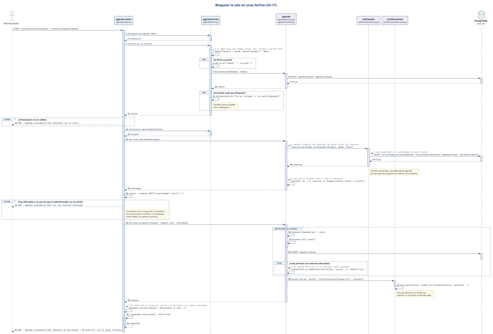

Para saber a quién le quita la sala, agenda pregunta por la señal
`reservas_aprobadas` en vez de importar a quien tiene las reservas, porque
`solicitudes` depende de agenda y no al revés. Contesta `solicitudes` con las
aceptadas y no canceladas de esas fechas. La primera vez no se guarda nada si hay reservas afectadas
(AC4): se muestran, y al confirmar el navegador devuelve sus códigos. Si ya no
coinciden, se vuelven a mostrar antes de avisar a nadie. Los correos salen con
`transaction.on_commit`, así un bloqueo que no alcanzó a guardarse no avisa.

### Levantar un bloqueo (US-17)

Levantar no borra la fila: la marca con quién, cuándo y por qué (AC5 y AC6), y
`vigentes()` deja de contarla. Es un `UPDATE` condicionado a que siga vigente,
para que dos administradores levantando el mismo bloqueo a la vez no pisen el
registro del primero.

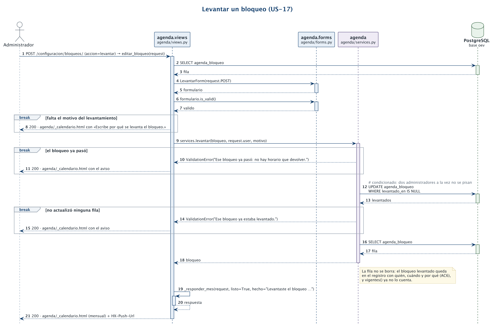

### Ver una semana con sus bloqueos (US-17)

La vista semanal tiene fechas porque desde ahí se bloquea un bloque en una
fecha, pero lo que se edita sigue siendo la jornada que se repite: lo dice el
pop-up de cada bloque. Cada columna raya los bloques que algún bloqueo deja fuera en su fecha,
con la misma regla `cubre()` que usa el resto del sistema.

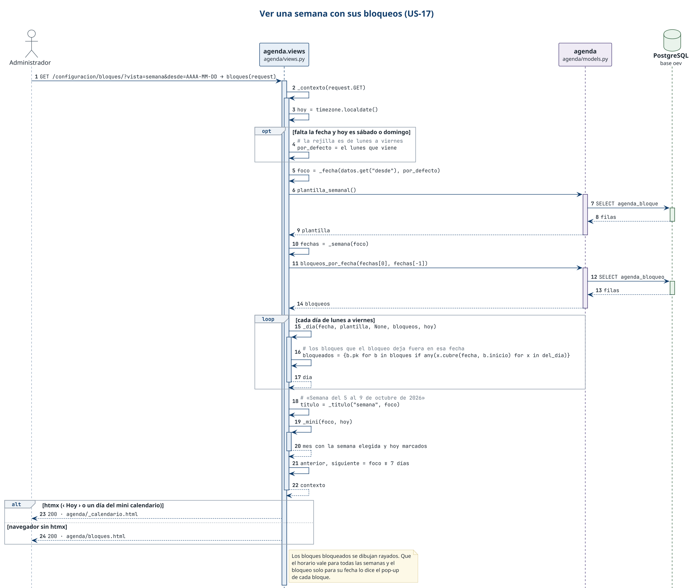

Un sábado o domingo, sin fecha en la dirección, la vista abre la semana que
viene, porque la rejilla es de lunes a viernes.

### Pedir la sala con una sanción vigente (US-10)

`solicitar` y `solicitar_area` preguntan primero por `Usuario.sancion_vigente`,
antes que por el área. Con una sanción vigente devuelven
`solicitudes/sancionado.html` con el motivo y desde cuándo se puede volver a
pedir, también ante un POST de cualquier paso. `guardar_solicitud_completa`
repite la pregunta, para el POST que llegue sin pasar por la vista.

La vigencia se calcula al leer, contra `timezone.localdate()` en America/Santiago:
rige desde `inicio` hasta las 23:59 de `termino`, ambos incluidos, y al día
siguiente la consulta ya no la encuentra. No hay tarea programada que la apague.
La franja de aviso es un include de `solicitudes/_base.html`, así que sale en
todas las páginas del solicitante con la misma consulta.

AC6 quedó decidido el 20/10: la sanción solo impide pedir. Las reservas ya
aceptadas y las solicitudes en revisión siguen su curso, así que crear una
sanción no cancela ni avisa a nadie.

### Levantar una sanción (US-10)

Crear y acortar sanciones es del superusuario, en la administración de Django.
El administrador las levanta desde la pestaña **Sanciones** del panel. Como en
los bloqueos de US-17, levantar no borra la fila: la marca con quién, cuándo y
por qué con un `UPDATE` condicionado a que siga vigente.

### Editar el listado y registrar un check-out (US-20)

El código de esta funcionalidad está agrupado en `src/uso/checkout/`, con sus
plantillas en `src/uso/templates/uso/checkout/` y los recursos visuales en
`src/uso/static/uso/checkout/`.

El administrador prepara secciones y preguntas en el editor visual y las publica
con una revisión. El servidor valida la estructura y bloquea la configuración
durante la publicación; una edición desactualizada no sobrescribe cambios ajenos.

El check-out usa ese listado y valida en el servidor todas las respuestas, la hora
de salida y las evidencias: cada **No** exige una observación de al menos 10
caracteres y una foto válida de hasta 5 MB. Se bloquean el ticket y el listado
durante el envío para evitar duplicados y comprobar la revisión vigente. Cada
reporte guarda una copia del listado respondido para conservar el historial.

[Diagrama de secuencia en PlantUML](diagramas/us-20/editar-checkout.puml).
Este flujo reemplaza el registro simulado de US-14 y conecta las validaciones
de integridad del prototipo de US-15 con la persistencia del check-out.

## Estructura

### Arquitectura

La aplicación es un monolito Django, modular y en tres capas: presentación,
dominio y persistencia. Cada app tiene su vista en presentación y sus modelos y
servicios en dominio, y cada vista queda sobre su app. MTV cruza dos capas: la
View y la Template están en presentación, y el Model en dominio. Cada flecha continua es un import
entre apps que está en el código, y su rótulo dice qué se usa del otro lado. Lo
punteado está planificado; la flecha punteada de dominio a persistencia es el
ORM.

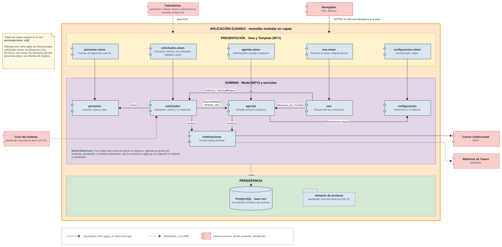

Las dependencias van en una sola dirección: `uso` usa a `solicitudes`, que usa a
`agenda`, que usa a `configuracion`. `agenda` no importa a `solicitudes`: para
saber qué reservas pierde un bloqueo le pregunta por la señal
`reservas_aprobadas` (ver Bloquear la sala en unas fechas). Las FK a
`personas_usuario` desde `agenda` y `configuracion` no se dibujan, porque se
escriben como texto (`settings.AUTH_USER_MODEL`) y no importan el modelo.
