# Manual de uso

Sistema de gestión de horarios y uso de la sala de grabación de la Facultad de Ciencias de la Ingeniería, UACh.

Este manual cubre lo que hoy está disponible en el sistema, ordenado por rol:

| Historia | Quién la usa | Sección |
|---|---|---|
| US-01 Inicio de sesión | Todos | [Iniciar sesión](#1-iniciar-sesión) |
| US-02 Solicitud de reserva | Solicitante | [Solicitar una reserva](#solicitar-una-reserva) |
| US-09 Historial de solicitudes | Solicitante | [Mis solicitudes](#mis-solicitudes) |
| US-03 Confirmar la asistencia | Solicitante | [Confirmar la asistencia](#confirmar-la-asistencia) |
| US-10 Historial de sanciones | Solicitante y administrador | [Mis sanciones](#mis-sanciones) y [Sanciones](#sanciones) |
| US-07 Panel del validador | Validador y administrador | [Validador](#3-validador) |
| US-04 Panel de administrador | Administrador | [Jornada semanal](#jornada-semanal) y [Reglas](#reglas-los-parámetros-del-sistema) |
| US-17 Bloquear fechas de la sala | Administrador | [Bloquear fechas de la sala](#bloquear-fechas-de-la-sala) |
| US-14 Bloques del personal de apoyo | Personal de apoyo | [Bloques del día](#bloques-del-día) |
| US-15 Checklist de cierre (prototipo) | Personal de apoyo | [Checklist de cierre de la sala](#checklist-de-cierre-de-la-sala) |

## Puertas de acceso

Cada rol entra por su propia dirección. Solo la del solicitante está enlazada
desde el sitio; las otras tres las conoce quien las usa. Cada puerta se reconoce
por el panel de la izquierda, con el nombre y el color del rol.

| Rol | Dirección | Panel |
|---|---|---|
| Solicitante | `/solicitante/entrar/` | Azul, **Solicitantes** |
| Administrador | `/configuracion/entrar/` | Azul petróleo, **Administración** |
| Validador | `/validacion/entrar/` | Vino, **Validación** |
| Personal de apoyo | `/apoyo/entrar/` | Gris azulado, **Personal de apoyo** |

### Dar un rol a alguien

Mientras la pestaña **Áreas** no tenga contenido (US-05), los roles se asignan
desde `/admin` con la cuenta de administrador: en **Usuarios**, abre la cuenta de
la persona, agrégale el grupo de su rol (**Solicitante**, **Validador**,
**Personal de apoyo** o **Administrador**) y guarda. Un solicitante necesita
además al menos un área académica activa. Una persona puede tener más de un rol
a la vez.

---

## 1. Iniciar sesión

### Entrar

1. Abre la dirección de tu rol.
2. Escribe tu correo institucional y tu contraseña. Marca **Ver contraseña** si
   quieres revisar lo que escribiste.
3. Pulsa **Iniciar sesión**. El sistema te lleva al panel de esa puerta. Si
   tienes más de un rol, la puerta por la que entras decide a qué panel llegas.

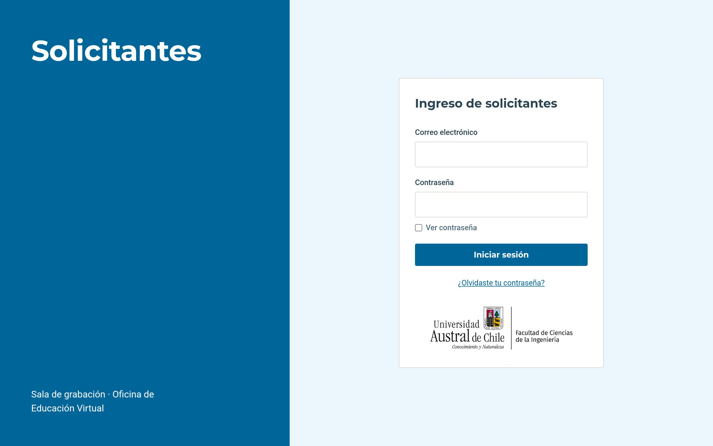

### Si no puedes entrar

Si el correo o la contraseña no coinciden, aparece el aviso **Correo o
contraseña incorrectos.**, junto con cuántos intentos seguidos bloquean la cuenta
y por cuántos minutos. El correo queda escrito para que no tengas que repetirlo.
Las mayúsculas del correo no importan.

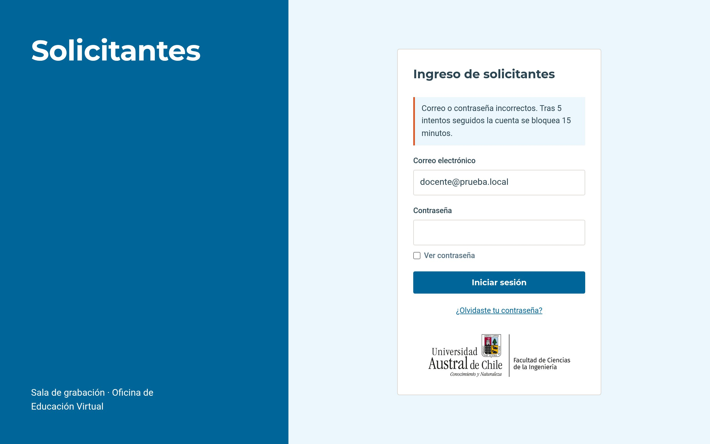

El aviso es el mismo cuando el correo no existe, cuando la cuenta no tiene el rol
de esa puerta o cuando está bloqueada. Así nadie puede usar la pantalla para
averiguar qué cuentas existen.

Después de esos intentos fallidos seguidos, la cuenta se bloquea por esos
minutos: mientras dure, ni la contraseña correcta la abre. Cuántos intentos y
cuántos minutos lo decide el administrador (ver
[Reglas](#reglas-los-parámetros-del-sistema)).

### Recuperar la contraseña

1. En la pantalla de ingreso, pulsa **¿Olvidaste tu contraseña?**.
2. Escribe tu correo y pulsa **Enviar enlace**.
3. Abre el enlace que llega a tu correo, escribe la contraseña nueva dos veces y
   pulsa **Guardar**.
4. Con el mensaje **Listo**, vuelve a iniciar sesión con la contraseña nueva.

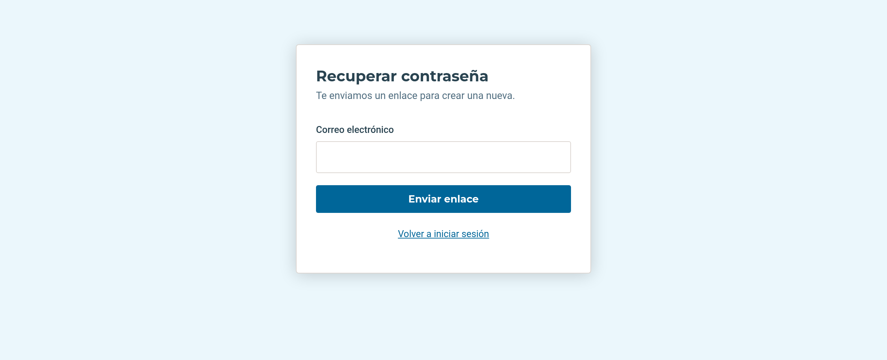

El enlace sirve una sola vez y vence en unas horas. Si ya no funciona, la
pantalla ofrece **Pedir otro enlace**.

### Avisos

Lo que resulta de una acción, como guardar, bloquear o retirar, aparece como un
aviso abajo a la derecha. Se va solo después de unos segundos; la **×** lo
cierra antes.

---

## 2. Solicitante

### Solicitar una reserva

Aquí se pide una reserva de la sala de grabación. Se entra por
`/solicitante/entrar/` y el formulario está en `/solicitar/`. Son tres pasos:
**Horario y disponibilidad**, **Datos de la actividad** y **Confirmación**.
Enviar la solicitud no la confirma: queda **en revisión** hasta que la acepte un
validador.

Tu cuenta necesita el rol **Solicitante** y al menos un área académica activa
(ver [Dar un rol a alguien](#dar-un-rol-a-alguien)). Si no perteneces a ninguna,
en vez del formulario aparece el aviso **No puedes solicitar todavía**, que te
pide pedirle al administrador que te asocie a tu área.

**Elegir el área académica**

Si perteneces a más de un área, lo primero es elegir para cuál es la grabación.
Selecciónala y pulsa **Continuar al calendario**. Si perteneces a una sola, este
paso no aparece.

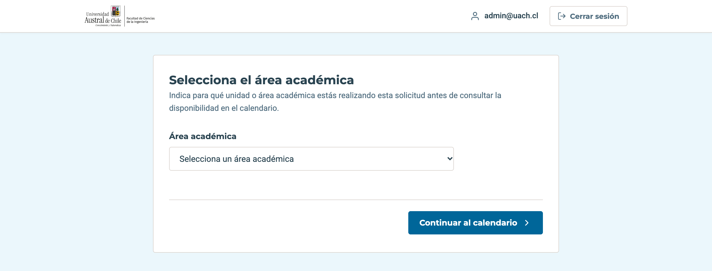

Para cambiarla después, pulsa **Cambiar área** en el paso 1. Cambiar de área
borra el día y los bloques que ya habías marcado.

**Paso 1: elegir el día y los bloques**

1. En el calendario, los días que se pueden pedir aparecen destacados y con un
   punto. Arriba se indica desde qué fecha se puede solicitar: entre la
   solicitud y la grabación tienen que pasar las semanas de desfase que fija el
   administrador (ver [Reglas](#reglas-los-parámetros-del-sistema)). Sábados y
   domingos no se pueden pedir.
2. Para moverte entre meses usa **Anterior** y **Siguiente**, o los selectores
   de mes y año. Solo se puede pedir con unos meses de anticipación.
3. Haz clic en un día. Abajo aparecen sus bloques horarios.
4. Marca uno o más bloques. Cada uno dice **Disponible** o, al marcarlo,
   **Seleccionado**. Los que ya están reservados o bloqueados no aparecen, y los
   que ya pediste tú aparecen como **Ya solicitaste este bloque · Pendiente** y
   no se pueden marcar de nuevo.
5. Pulsa **Continuar a datos de la actividad**.

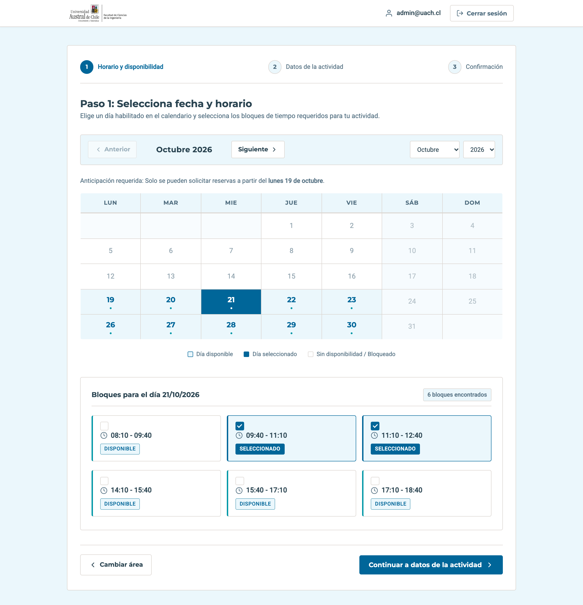

**Paso 2: completar los datos de la actividad**

1. Arriba se ve el día y los bloques elegidos. **Cambiar horario** vuelve al
   paso 1.
2. **Solicitante.** Tu nombre, tu correo y el área elegida, tomados de tu
   cuenta. No se pueden cambiar aquí.
3. **Motivo de la solicitud** (obligatorio, hasta 300 caracteres). Para qué
   usarás la sala, por ejemplo *grabación de cápsula para el módulo de Bases de
   Datos*.
4. **Cantidad de personas en sala.** De 1 a 5, contándote a ti. Por cada
   persona adicional aparece un recuadro **Acompañante** para su nombre y
   correo, hasta 4 acompañantes.
5. Pulsa **Continuar a confirmación**. **Volver al calendario** regresa al paso
   1.

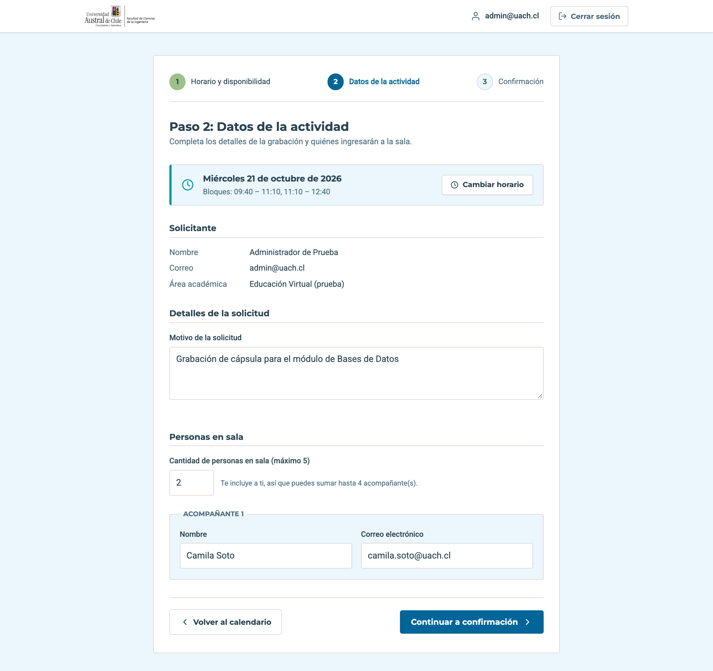

Si algo no cuadra, el paso 2 vuelve con lo que escribiste y el aviso
correspondiente. Por ejemplo, al declarar 3 personas con un solo acompañante
completo:

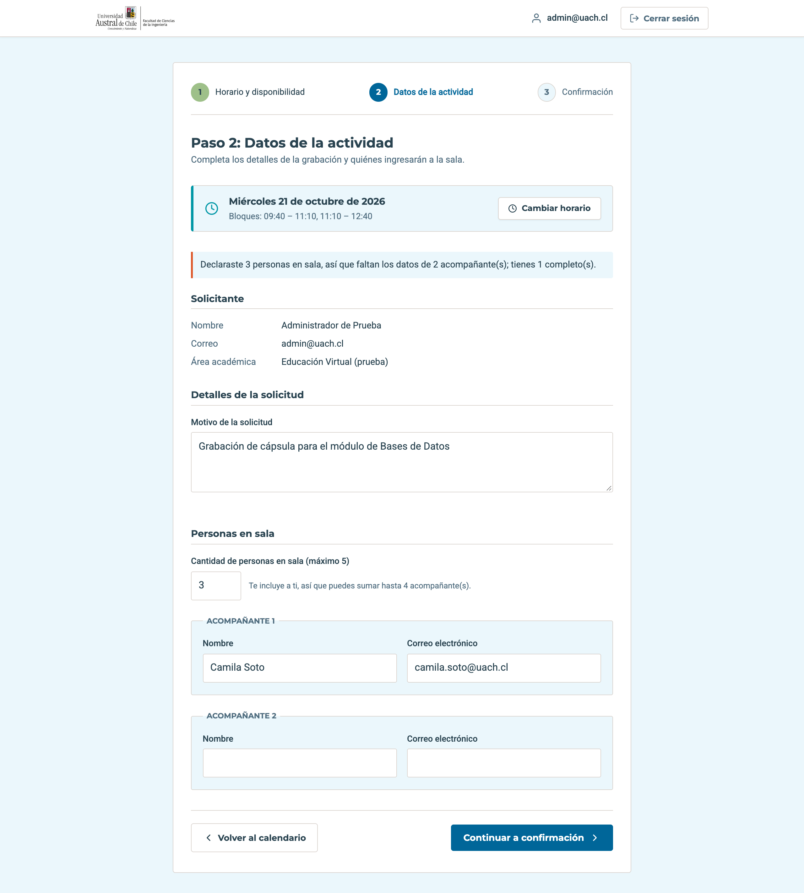

**Paso 3: revisar y enviar**

1. Revisa el **Resumen de la reserva**: fecha, horario, solicitante, área,
   motivo, personas y acompañantes. **Modificar datos** vuelve al paso 2.
2. Lee los **Términos y condiciones** y marca **He leído y acepto los términos
   y condiciones de uso de la sala**. El botón no se activa hasta marcar la
   casilla.
3. Pulsa **Confirmar y enviar solicitud**.

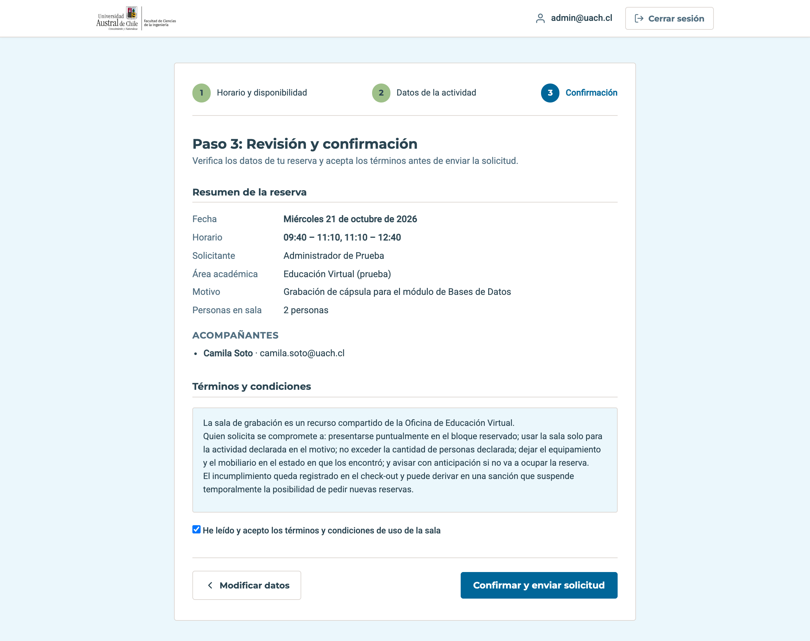

Al enviarla aparece **Solicitud completa**, con el número de la solicitud, que
queda en revisión, y el resumen de lo enviado. **Hacer otra solicitud** empieza
de nuevo.

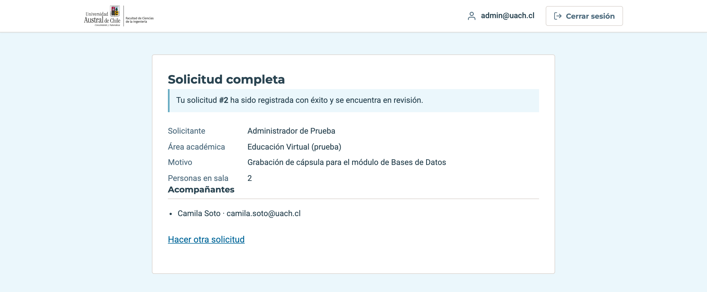

Lo que eliges en cada paso queda guardado mientras completas el formulario. La
solicitud se registra recién al pulsar **Confirmar y enviar solicitud**.

| Paso | Situación | Aviso |
|---|---|---|
| Área | No se eligió un área | Por favor, selecciona un área académica para continuar. |
| 1 | No se eligió un día | Por favor, selecciona un día disponible en el calendario. |
| 1 | El día está fuera del período que se puede pedir | La fecha seleccionada no está dentro del período permitido. |
| 1 | No se marcó ningún bloque | Por favor, selecciona al menos un bloque de horario para continuar. |
| 1 | Alguien reservó un bloque mientras lo elegías | Uno o más de los bloques seleccionados ya no están disponibles. Por favor, selecciona otros. |
| 2 | Falta el motivo | El motivo es obligatorio. |
| 2 | Más de 5 personas en sala | Como máximo 5 personas en sala. |
| 2 | Menos de 1 persona en sala | Al menos tienes que entrar tú. |
| 2 | Faltan datos de acompañantes, por ejemplo 3 personas con 1 acompañante completo | Declaraste 3 personas en sala, así que faltan los datos de 2 acompañante(s); tienes 1 completo(s). |
| 2 | Un acompañante tiene nombre pero no correo, o al revés | Falta el correo de esta persona. / Falta el nombre de esta persona. |
| 2 | Dos acompañantes tienen el mismo correo | Hay un correo repetido entre los acompañantes. |
| 2 | Se incluyó tu propio correo como acompañante | Tu propio correo ya está incluido: eres parte de la cuenta de personas. |
| 3 | No se aceptaron los términos | Tienes que aceptar los términos y condiciones para enviar la solicitud. |

### Mis solicitudes

La pestaña **Mis solicitudes**, arriba junto a **Solicitar reserva**, muestra
todas tus solicitudes, de cualquiera de tus áreas, con su estado actual. Está en
`/solicitar/mis-solicitudes/`.

Se separan en dos pestañas, cada una con cuántas tiene:

- **Próximas**: las de hoy en adelante, la más cercana primero. Una de hoy sigue
  aquí aunque su hora ya haya pasado.
- **Anteriores**: las de días que ya pasaron, la más reciente primero.

Cada fila dice el número de la solicitud, el área, la fecha, los bloques y el
estado. Se muestran de a 20; si hay más, abajo aparecen **Anterior** y
**Siguiente**.

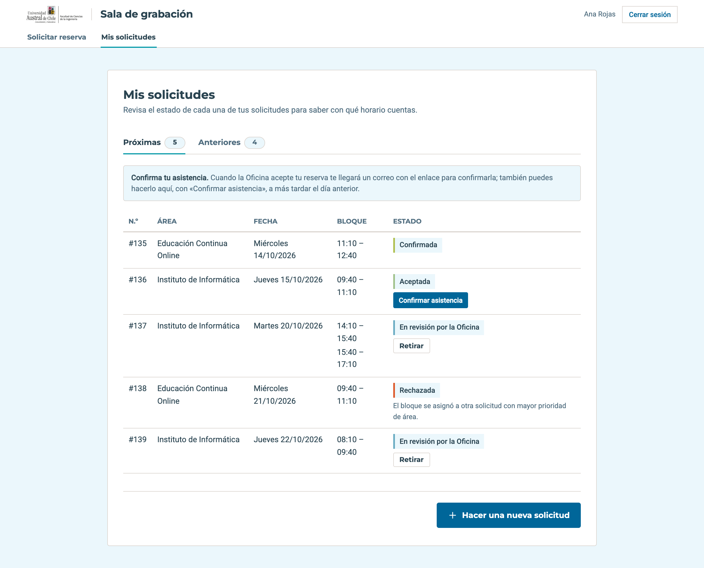

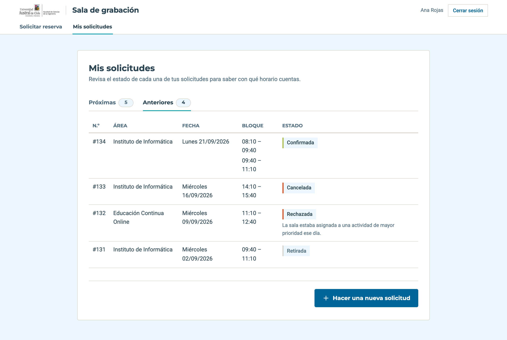

| Estado | Qué significa |
|---|---|
| **En revisión por la Oficina** | La Oficina todavía no la revisa. Se puede **Retirar** |
| **Aceptada** | La Oficina la aceptó. Falta confirmar la asistencia: aparece **Confirmar asistencia** |
| **Pendiente de confirmación** | Ya te llegó el recordatorio. Aparecen la fecha límite, **Confirmar asistencia** y **Cancelar reserva** |
| **Confirmada** | Confirmaste que vas a usar la sala. Todavía se puede **Cancelar reserva** |
| **Rechazada** | La Oficina la rechazó. Debajo va el motivo que escribió |
| **Cancelada** | Se canceló después de aceptada: la cancelaste tú o la Oficina le quitó el horario, con un correo que dice por qué. Si la cancelaste en la semana de la reserva, dice que cuenta como inasistencia |
| **No confirmada (inasistencia)** | Llegó su día sin confirmar: el horario se liberó y queda como inasistencia |
| **Retirada** | La retiraste antes de que la Oficina la revisara |

**Retirar una solicitud**

Solo se puede retirar una solicitud **En revisión por la Oficina**. Una vez
aceptada o rechazada, el botón ya no aparece.

1. Pulsa **Retirar** en la fila de la solicitud.
2. Se abre un recuadro que pide confirmarlo. **Retirar solicitud** la retira;
   **Cancelar**, Esc o un clic fuera del recuadro lo cierran sin cambiar nada.

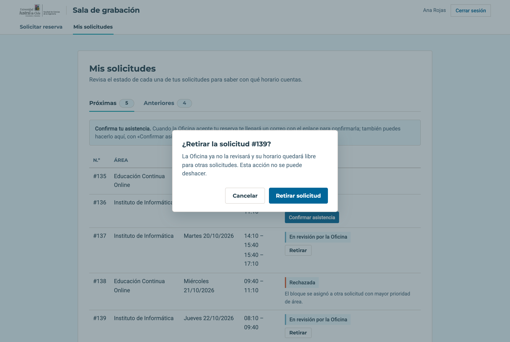

La solicitud queda **Retirada** en la misma pestaña, y el aviso dice **Retiraste
la solicitud #… Su horario queda libre.** No se borra: sigue en el historial. Si
la Oficina la revisó justo antes, el aviso dice que ya no está en revisión y no
cambia nada.

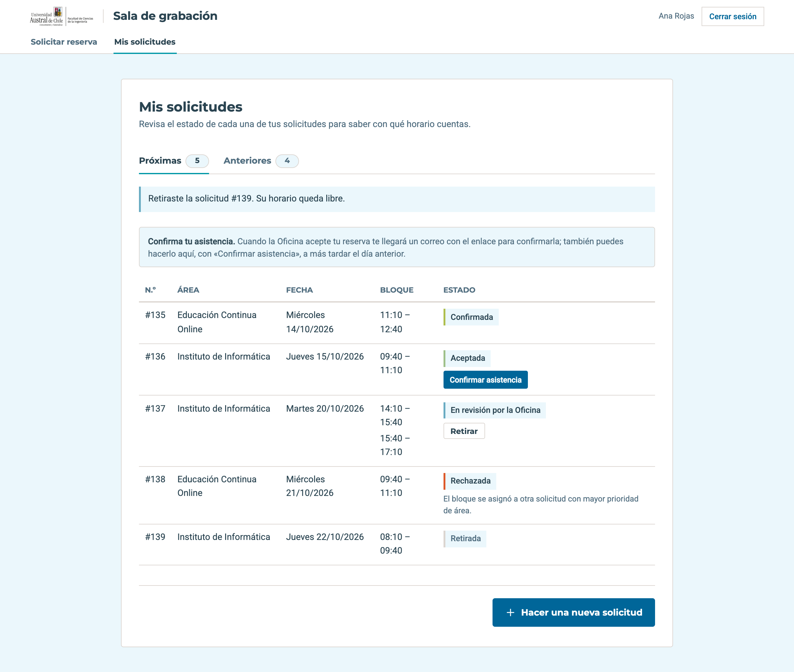

### Confirmar la asistencia

Cuando la Oficina acepta una reserva llega un correo con un enlace para
confirmarla. El mismo enlace está en **Mis solicitudes**, como **Confirmar
asistencia** bajo el estado de cada reserva aceptada.

| Paso | Qué pasa |
|---|---|
| Abrir el enlace | Sin sesión iniciada, pide entrar y después vuelve a la reserva |
| Ver la reserva | Muestra la fecha, el horario, el área y el motivo. Abrirla no confirma nada |
| **Confirmar asistencia** | La reserva queda **Confirmada** y vuelve a Mis solicitudes con el aviso |

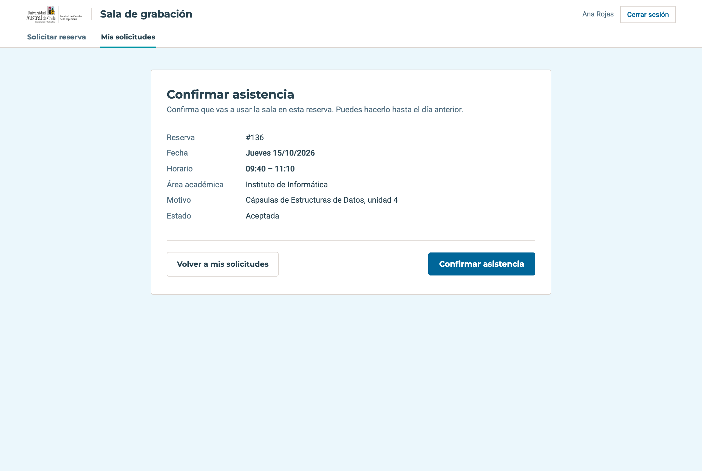

Al confirmar, vuelves a **Mis solicitudes** con el aviso **Confirmaste tu
asistencia a la reserva #…** y la fila queda **Confirmada**.

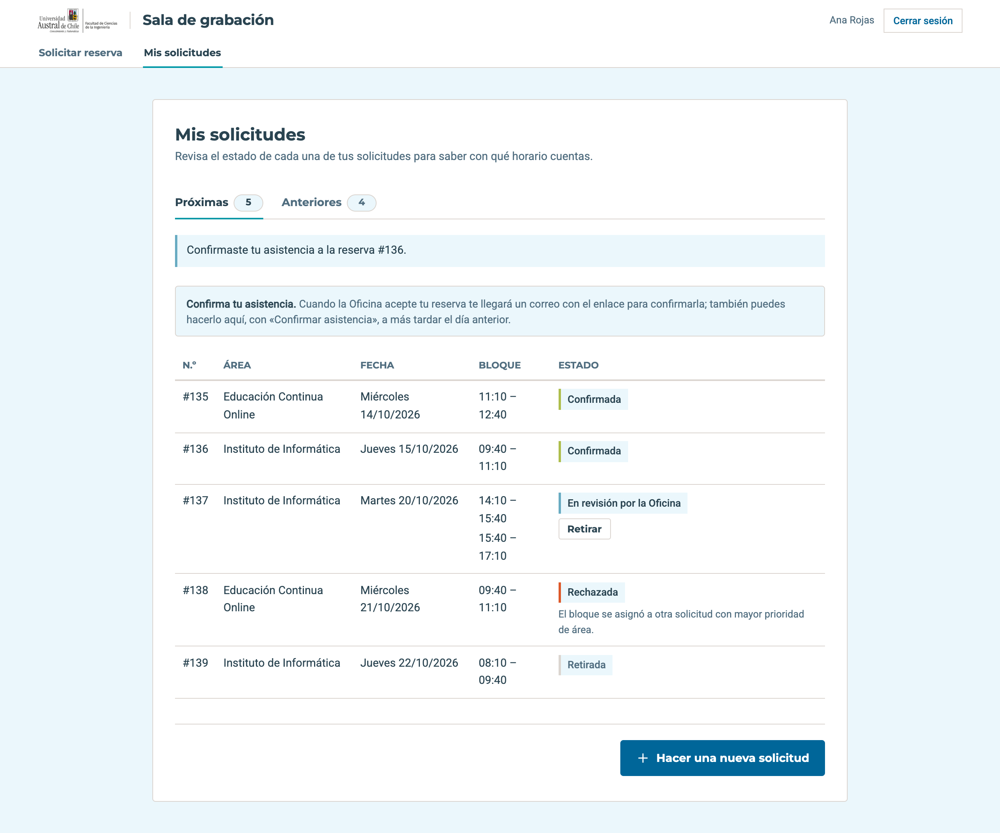

Se puede confirmar hasta el día anterior a la reserva. Si ya está confirmada,
cancelada o es el mismo día, la página lo dice y no muestra el botón.

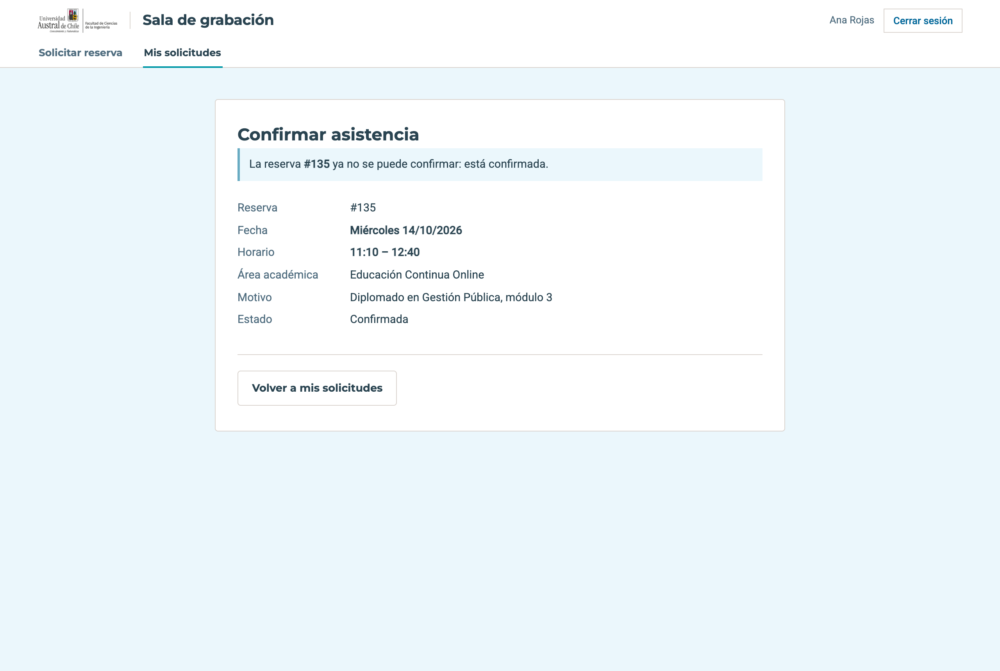

**El recordatorio**

Cuando falta el plazo de confirmación que fija la Oficina (hoy, dos días), llega
un segundo correo con el resumen de la reserva y dos enlaces: uno para confirmar
y otro para cancelar. Llega una sola vez, y no llega si ya confirmaste.

Desde ese momento, al entrar al sistema aparece una franja bajo el encabezado:
**Tienes N reservas por confirmar**, con un enlace a Mis solicitudes. En la
fila, la reserva queda **Pendiente de confirmación** con la fecha límite.

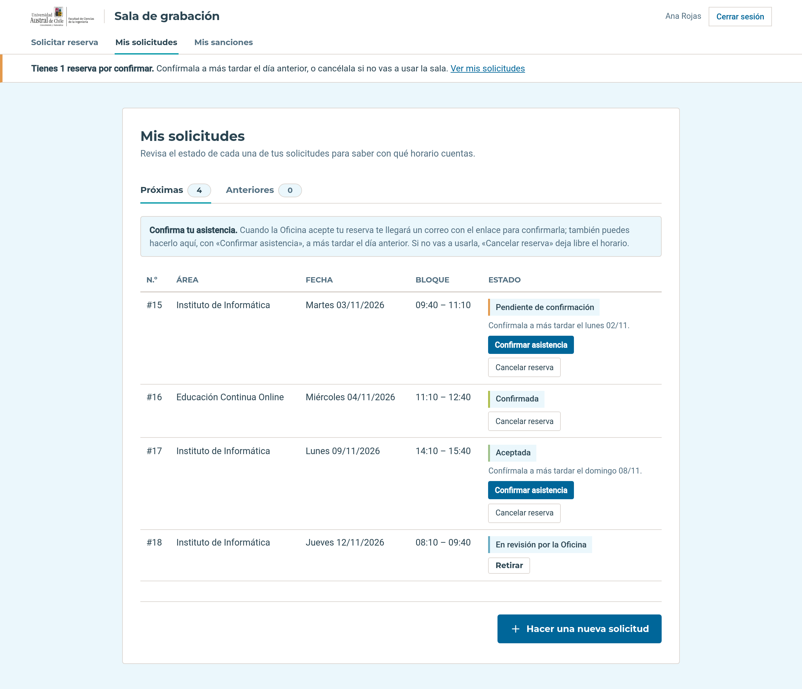

Si llega el día de la reserva sin confirmar, su horario se libera y queda
**No confirmada (inasistencia)**.

**Cancelar una reserva**

Una reserva aceptada, confirmada o no, se puede cancelar hasta que empiece su
primer bloque.

| Paso | Qué pasa |
|---|---|
| **Cancelar reserva** | En la fila de Mis solicitudes o desde el enlace del recordatorio. Abre una página con la reserva; abrirla no cancela nada |
| **Sí, cancelar la reserva** | La reserva queda **Cancelada**, su horario vuelve a ofrecerse y la Oficina recibe un correo |

Cancelar antes de la semana de la reserva no tiene consecuencias. Desde el lunes
de esa semana, la página avisa que cancelar cuenta como **inasistencia**.

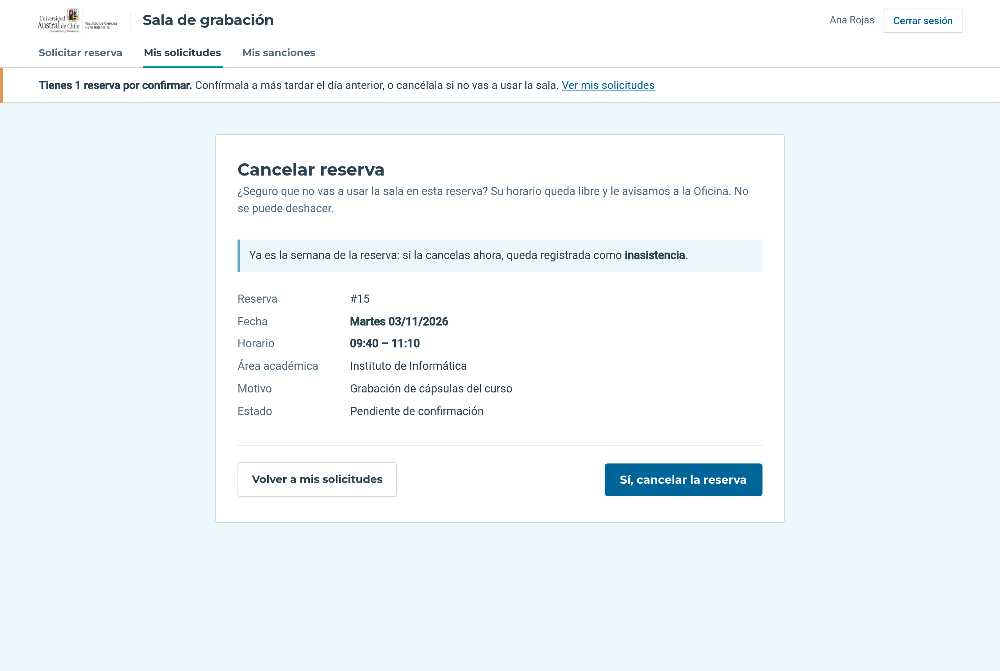

Al cancelar, vuelves a **Mis solicitudes** con el aviso **Cancelaste la reserva
#…** y la fila queda **Cancelada**.

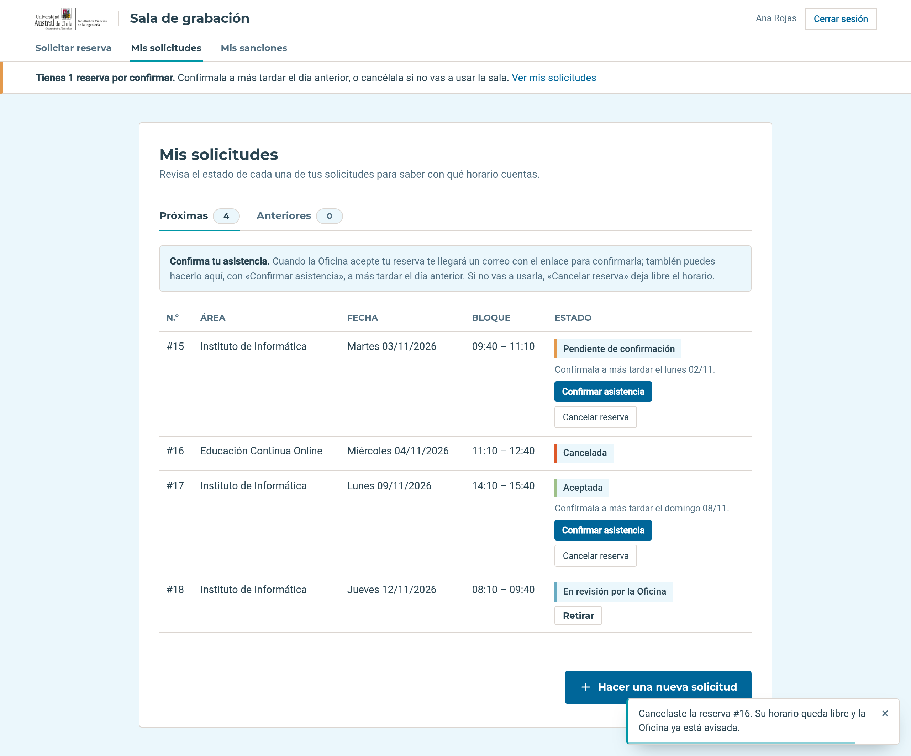

### Mis sanciones

Una sanción suspende por un tiempo la posibilidad de enviar solicitudes nuevas.
La pone la Oficina, por ejemplo tras inasistencias, con un motivo y un periodo.
Rige desde su primer día hasta las **23:59 de su último día**, en hora de Chile;
al día siguiente se puede volver a pedir sin hacer nada.

Mientras hay una sanción vigente:

- En todas las pantallas del solicitante aparece, bajo el encabezado, una franja
  que dice hasta cuándo rige y desde qué día se puede volver a solicitar.
- **Solicitar reserva** no muestra el formulario: aparece **No puedes solicitar
  por ahora**, con el motivo, el periodo y la fecha desde la que se puede pedir de
  nuevo.
- Las reservas ya **aceptadas** no cambian: se pueden confirmar y usar como
  siempre. Las que estaban **en revisión** también siguen: la Oficina las
  resuelve igual que antes.

La pestaña **Mis sanciones**, arriba junto a **Mis solicitudes**, muestra primero
la sanción vigente y debajo las anteriores, cada una con su motivo y su periodo.
Si la Oficina levantó una antes de tiempo, dice cuándo y por qué. Está en
`/solicitar/mis-sanciones/` y solo muestra las sanciones propias.

---

## 3. Validador

Aquí se revisan las solicitudes pendientes y se aprueba o rechaza cada solicitud
entera. Se entra por `/validacion/entrar/` y el panel está en `/validador/`. El
administrador tiene el mismo panel en la pestaña **Validación** de
`/configuracion/`.

| Al resolver | Qué pasa |
|---|---|
| Aprobar | La solicitud queda **Aceptada** y su bloque deja de ofrecerse en el calendario |
| Rechazar | La solicitud queda **Rechazada** con el motivo |
| En ambos casos | Queda guardado quién resolvió y a qué hora. El solicitante recibe un correo y ve el resultado en **Mis solicitudes** |

### Leer el panel

El panel es la jornada semanal, la misma que configura el administrador, con
quién pide cada bloque escrito adentro. Abre en la primera semana que tiene algo
por resolver; **←**, **Hoy** y **→** cambian de semana.

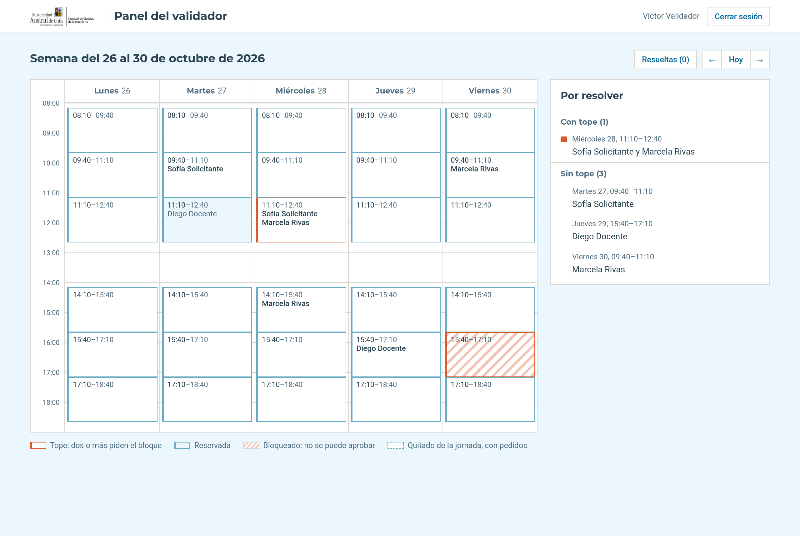

| Bloque | Qué indica |
|---|---|
| Con un nombre | Una solicitud pendiente lo pide |
| Borde rojo, con dos nombres o más | Tope: varias solicitudes piden ese bloque |
| Celeste, con el nombre en gris | Reservado: ya está aprobado para esa persona |
| Rayado | Bloqueado por el administrador: no se puede aprobar |
| Borde punteado | Quitado de la jornada, pero con pedidos de antes |

A la derecha, **Por resolver** lista los topes y las solicitudes sin tope de la
semana. Un clic en un bloque o en un elemento de la lista abre su detalle en ese
mismo panel; **Volver a la lista** regresa.

### Sin tope

Una solicitud que nadie más disputa se abre en su ficha: solicitante, área y su
prioridad, motivo, personas y acompañantes, cuándo se envió, la fecha y el
bloque.

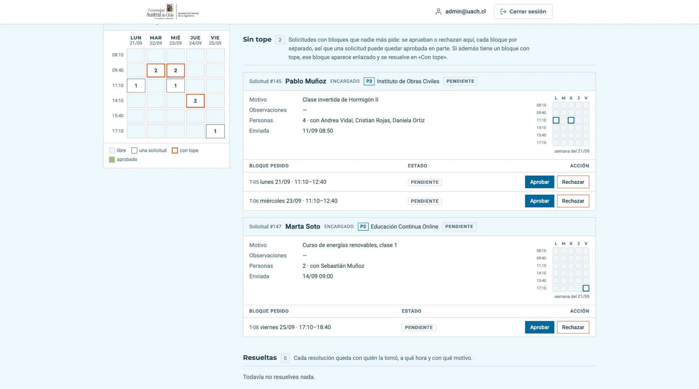

- **Aprobar**: se aprueba de inmediato.
- **Rechazar**: abre el campo **Motivo del rechazo** (mínimo 10 caracteres) y
  luego **Confirmar rechazo**. **Cancelar** lo cierra.

Si la solicitud choca con otra en algún bloque, la ficha lo dice y ofrece **Ver
el tope**: se resuelve ahí.

### Con tope

El tope lista las solicitudes que piden el mismo bloque en la misma fecha,
ordenadas por la prioridad de su área, con una sugerencia según esa prioridad.
De cada una se ve el solicitante, el área, el motivo y, si pide otros bloques,
cuáles. La elegida es la de mayor prioridad; marca otra para cambiarla.

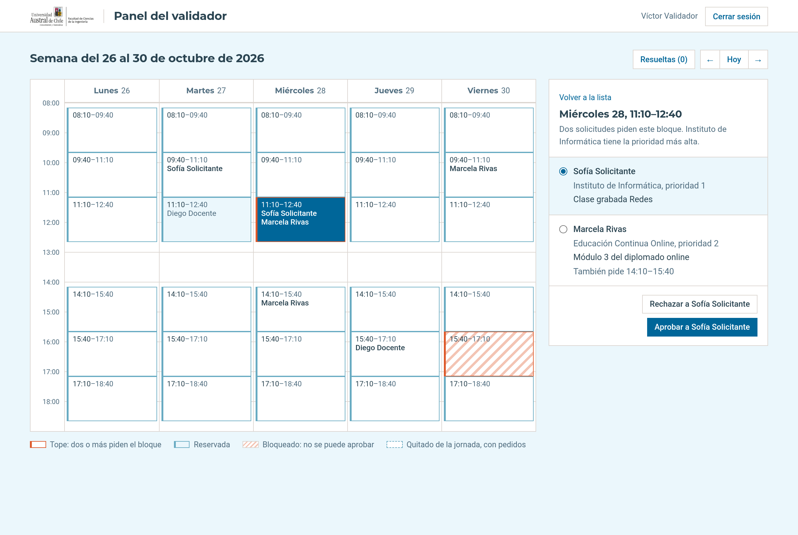

1. Pulsa **Aprobar a …** para darle el bloque a la elegida, o **Rechazar a …**
   para rechazar solo esa.
2. El panel dice quién obtiene el bloque y quién queda rechazada. Aprobar una
   rechaza enteras a las que chocan con ella.
3. Escribe el **Motivo del rechazo** (mínimo 10 caracteres). Les llega por
   correo a quienes pierden.
4. Pulsa **Confirmar**. **Volver** regresa al tope sin resolver.

Si confirmas sin motivo, el panel lo avisa y deja el cursor en el campo.

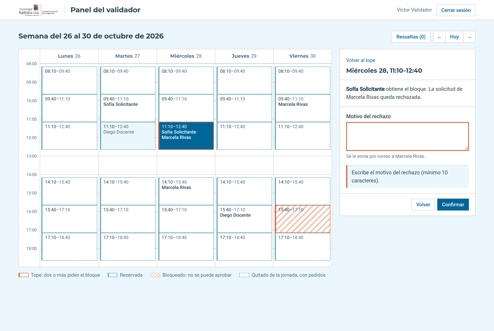

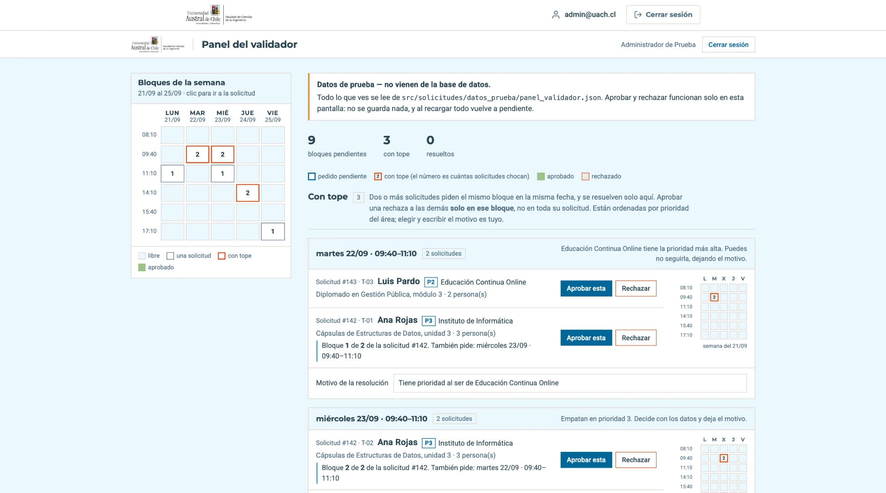

Al confirmar, el bloque queda reservado y el aviso resume lo que pasó, por
ejemplo **Aprobaste la solicitud de Sofía Solicitante. La de Marcela Rivas quedó
rechazada.**

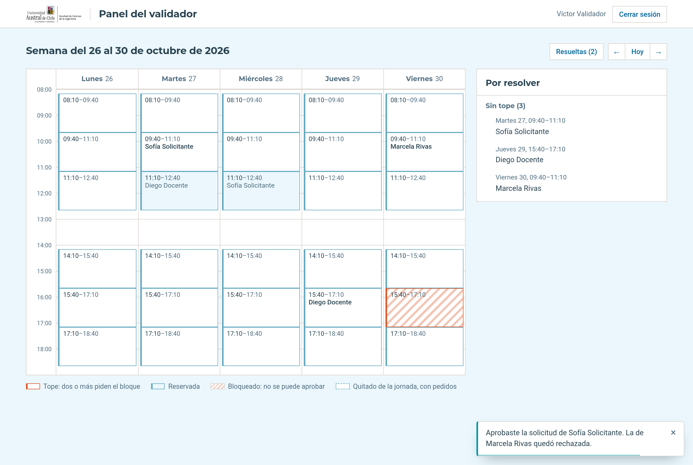

Si rechazas una en un tope de dos, la que queda se abre sola en su ficha.

### Resueltas hoy

**Resueltas (…)**, arriba, abre lo resuelto hoy por cualquier validador:
solicitud, resolución, motivo, quién y a qué hora. Una que perdió un tope dice a
quién se le asignó el bloque. Queda guardado: recargar la página no lo borra.

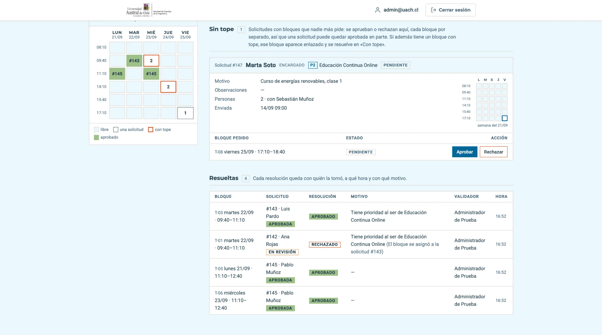

| Aviso | Cuándo |
|---|---|
| Escribe el motivo del rechazo (mínimo 10 caracteres). | Se rechaza, o se aprueba en un tope, sin motivo o con uno muy corto |
| La sala está bloqueada …: no se puede aprobar. Recházala con ese motivo. | Hay un bloqueo en ese horario |
| El bloque de las … ya no está en la jornada: no se puede aprobar. Recházala. | El administrador quitó el bloque después de que se pidiera |
| Esta solicitud ya fue resuelta o retirada. Recarga la página para ver lo último. | Otro validador la resolvió, o el solicitante la retiró, mientras tenías la página abierta |
| Uno de sus bloques ya está aprobado para otra solicitud ese día. | El bloque se aprobó para otra solicitud |
| No se pudo guardar. Recarga la página e inténtalo de nuevo. | La sesión venció o se perdió la conexión |

---

## 4. Administrador

El panel del administrador tiene cinco pestañas: **Bloques**, **Áreas**,
**Reglas**, **Validación** y **Sanciones**. Se entra por `/configuracion/entrar/`.

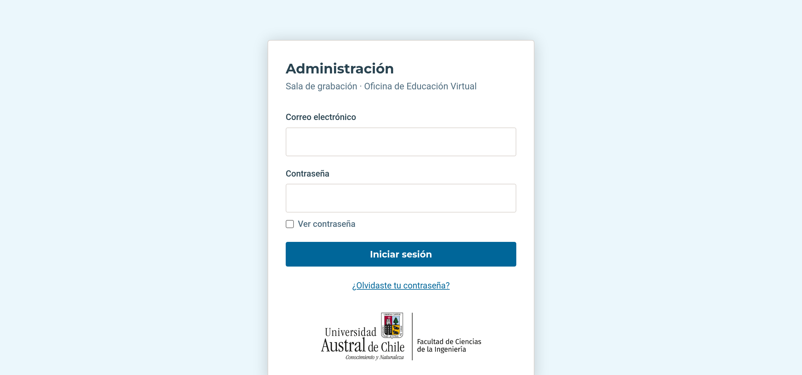

**Validación** es el panel del validador (ver [Validador](#3-validador)): el
administrador también aprueba y rechaza, y la resolución queda a su nombre. La
pestaña **Áreas** todavía no tiene contenido; llega con US-05.

### Jornada semanal

Un bloque es un tramo horario de un día de la semana, por ejemplo *lunes de
08:10 a 09:40*. La jornada se define una vez y se repite todas las semanas. Se
edita en la pestaña **Bloques**, vista **Semanal**.

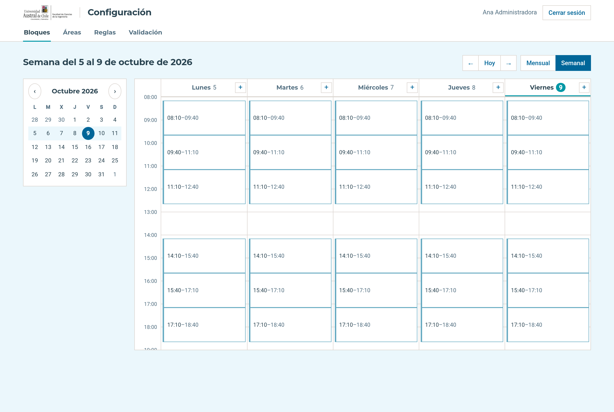

La vista semanal dice qué semana es y cada columna muestra su fecha, porque
desde ahí también se bloquea un bloque en una fecha. Para cambiar de semana usa
**←**, **Hoy** y **→**, o haz clic en un día del mini calendario de la izquierda.

**Agregar un bloque**

1. Pulsa **+** junto al nombre del día, o haz clic en un hueco de su columna.
2. En el recuadro, ajusta **Inicio** y **Término**, o la **Duración**, que se
   calcula sola.
3. Pulsa **Agregar el bloque**.

**Cambiar o quitar un bloque**

1. Haz clic sobre el bloque. Se abre un recuadro junto a él.
2. Cambia las horas y pulsa **Guardar el bloque**, o pulsa **Quitar de la
   jornada**. **Cancelar** o Esc lo cierran sin cambios.

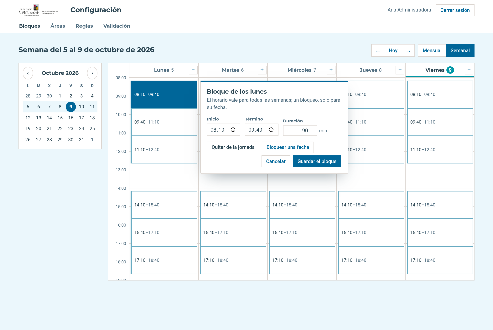

El recuadro recuerda que el horario vale para todas las semanas, y un bloqueo,
solo para su fecha. Si el bloque se cruza con otro del mismo día, no se guarda:
el error aparece en el recuadro y el otro bloque queda marcado. Quitar un bloque
no pide confirmación; el aviso trae **Reponerlo**, por si fue un error. Un
bloque quitado nunca se borra, así que las solicitudes que ya lo apuntan siguen
siendo válidas.

**Vista mensual**

La vista **Mensual** es la que abre por defecto. Muestra el mes completo y, en
la cabecera, cuántos bloques y horas tiene cada día de la semana. Sirve para
revisar la jornada y para bloquear fechas; no para editar bloques.

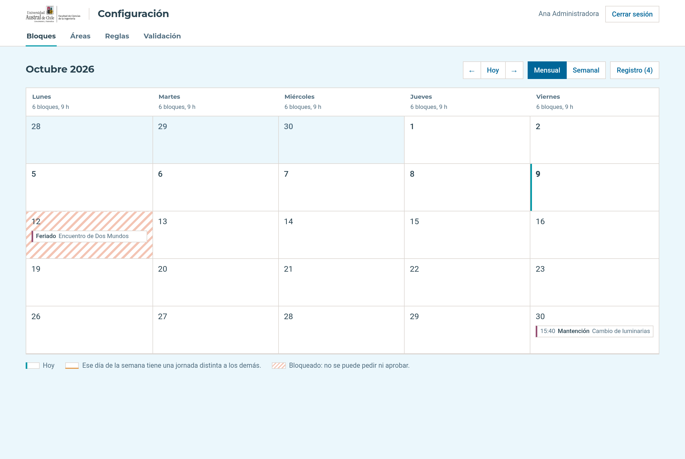

### Bloquear fechas de la sala

El administrador puede dejar la sala fuera de servicio por una **mantención**,
un **feriado** o un **evento**. El bloqueo vale para fechas concretas: la
jornada semanal sigue igual. Mientras está vigente, esos horarios no se pueden
solicitar ni aprobar, y quien solicita ve el motivo.

**Crear un bloqueo**

1. En la vista mensual, haz clic en el día que quieres bloquear.
2. En **Qué bloquear**, elige una opción:
   - **Todo el día**.
   - **Un bloque**, por ejemplo de 08:10 a 09:40.
   - **Varios días**: bloquea los días completos entre la fecha elegida y la
     que marques como término. Puedes marcarla con otro clic en el calendario.
3. Elige el **Motivo**: Mantención, Feriado o Evento. Si quieres, agrega un
   **Detalle**, como *Taller de profesores*. El solicitante lo ve.
4. Pulsa **Bloquear**.

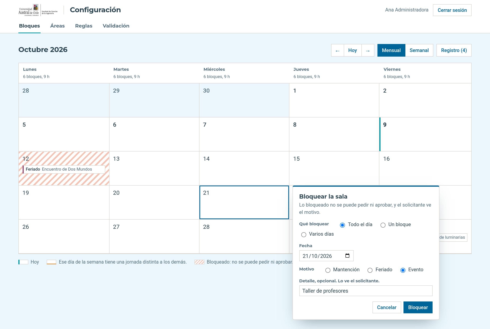

El día queda rayado y el aviso confirma lo bloqueado, por ejemplo **Bloqueaste
la sala el miércoles 21 de octubre, todo el día (Evento: Taller de
profesores).**

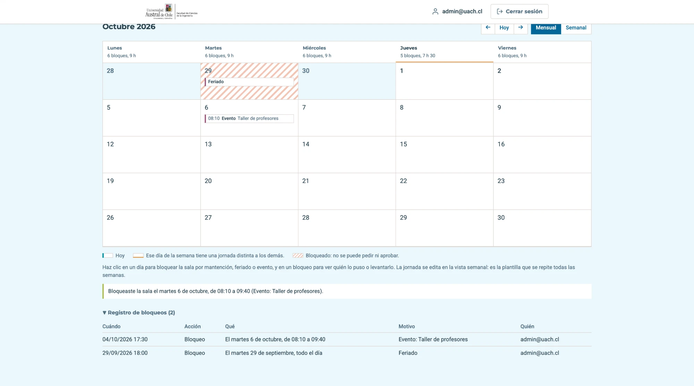

No se puede bloquear un día que ya pasó, una fecha sin jornada ni algo que ya
está bloqueado entero. Si el bloqueo le quita la sala a reservas aprobadas que
todavía no empiezan, el sistema no lo guarda a la primera: muestra esas
reservas en el recuadro para que revises a quién afecta, y el botón pasa a ser
**Bloquear y avisar**. Al pulsarlo, guarda el bloqueo y avisa por correo a cada
persona afectada.

**Bloquear un bloque desde la vista semanal**

Haz clic en el bloque, pulsa **Bloquear una fecha**, elige la fecha (viene
elegida la de la semana que estás mirando) y el motivo, y pulsa **Bloquear esa
fecha**. Los bloques bloqueados en esa semana aparecen rayados.

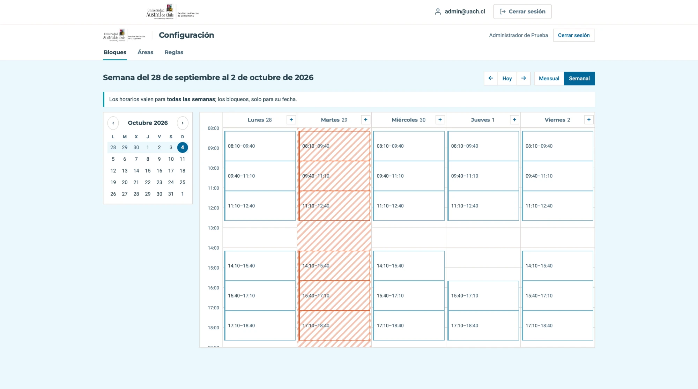

**Ver y levantar un bloqueo**

Haz clic en el bloqueo, dentro de su día en la vista mensual. El recuadro dice
el motivo, las fechas y quién lo registró. Para devolver el horario, escribe el
**Motivo para levantarlo** y pulsa **Levantar el bloqueo**.

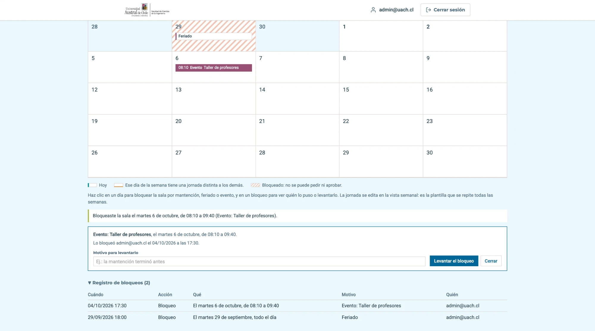

El horario vuelve a estar disponible y queda anotado quién levantó el bloqueo,
cuándo y por qué. Un bloqueo que ya pasó no se puede levantar.

**Registro (…)**, arriba de la vista mensual, abre las últimas acciones,
bloqueos y levantamientos, con fecha, qué se bloqueó, motivo y responsable.

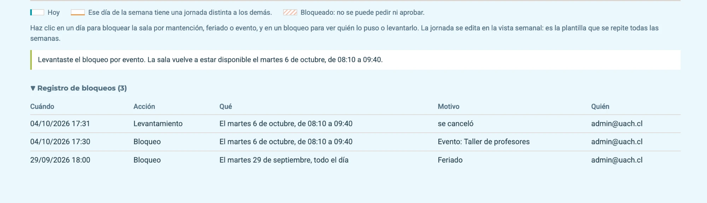

> **Estado actual.** Las reservas que un bloqueo afecta son las solicitudes
> aceptadas y no canceladas de esas fechas. En desarrollo, los correos de aviso
> se escriben en el log del contenedor en vez de enviarse.

### Reglas: los parámetros del sistema

Aquí se ajustan los umbrales con los que opera el sistema, sin reinstalar nada.
Cada fila explica qué hace el sistema con ese valor.

| Grupo | Parámetros |
|---|---|
| Recepción de solicitudes | Día y hora límite para pedir la semana siguiente, desfase mínimo en semanas |
| Reserva | Días de anticipación para confirmar, tope mensual por persona, bloques por solicitud |
| Cierre y sanciones | Inasistencias para sancionar, duración de la sanción |
| Acceso | Intentos antes de bloquear una cuenta, duración del bloqueo |
| Términos y condiciones | El texto que acepta el solicitante al enviar una solicitud |

Para cambiar valores:

1. Modifica los que necesites.
2. Pulsa **Guardar cambios**.

El aviso dice cuántos cambios quedaron guardados. Los cambios rigen para las
solicitudes nuevas; las que ya se enviaron no cambian. Si un valor está fuera de
su rango permitido, la fila se marca y no se guarda nada.

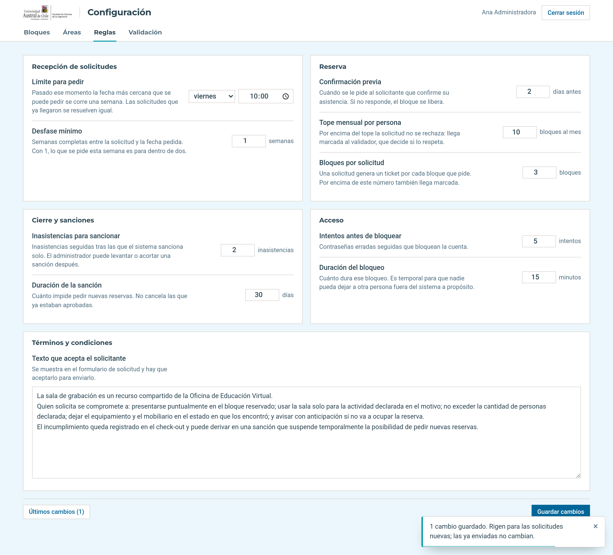

**Últimos cambios (…)**, al pie, abre los últimos 15: quién cambió cada
parámetro, cuándo y de qué valor a cuál.

### Sanciones

Una sanción impide a un solicitante enviar solicitudes nuevas desde su fecha de
inicio hasta las 23:59 de su fecha de término. **No cancela sus reservas ya
aceptadas ni sus solicitudes en revisión** (decisión del 20/10 sobre AC6 de
US-10).

**Crear o acortar una sanción** lo hace solo el superusuario, en `/admin`:
**Personas › Sanciones › Añadir**, con la persona, el motivo, la fecha de inicio
y la de término. La de término es obligatoria y el inicio no puede ser una fecha
futura. Para acortarla se cambia la fecha de término. Las sanciones no se
borran, y el administrador sin cuenta de superusuario no las ve en `/admin`.

**Levantar una sanción** antes de tiempo se hace en la pestaña **Sanciones**, que
lista las vigentes con la persona, el motivo, el periodo y quién la puso:

1. En la fila, escribe el motivo del levantamiento. Es obligatorio.
2. Pulsa **Levantar**.

La persona puede volver a solicitar de inmediato y el aviso dice **Levantaste la
sanción de …**. La sanción no se borra: queda en su historial con quién la
levantó, cuándo y por qué. Si otra persona la levantó justo antes, o ya terminó,
el aviso lo dice y no cambia nada.

---

## 5. Personal de apoyo

Se entra por `/apoyo/entrar/`.

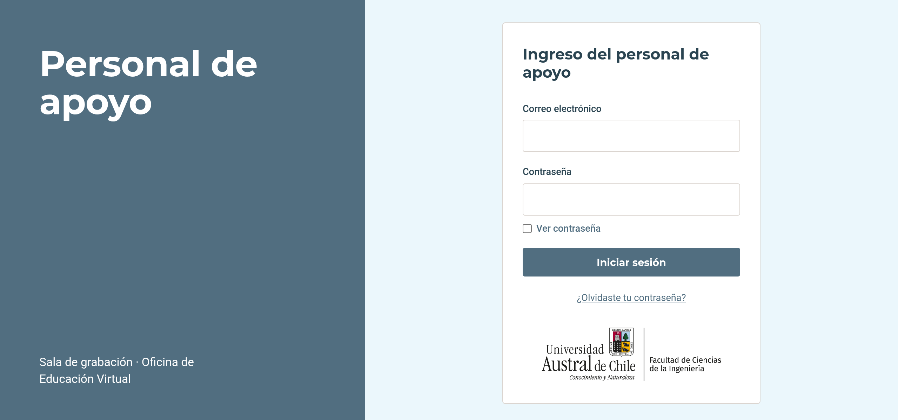

### Bloques del día

La vista muestra las reservas de la sala para un día. Al entrar se ven las de
hoy, ordenadas por hora de inicio.

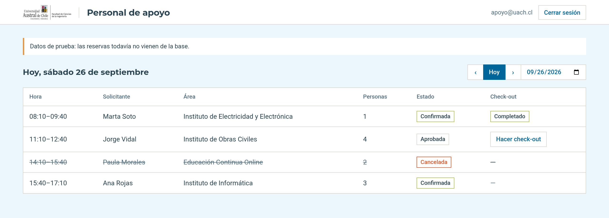

| Columna | Qué indica |
|---|---|
| Hora | Inicio y término del bloque |
| Solicitante | Quién pidió la sala |
| Área | El área académica de la reserva |
| Personas | Cuántas personas declaró el solicitante |
| Estado | **Aprobada** o **Confirmada**. Una **Cancelada** o **No confirmada** aparece tachada: ya no hay que esperar a nadie |
| Check-out | **Completado** si ya se registró, **Hacer check-out** si el bloque terminó y falta, o **—** si el bloque aún no termina, se canceló o no se confirmó |

Las reservas pendientes de aprobación no aparecen, porque todavía pueden
rechazarse. Todo el personal de apoyo ve todos los bloques; no se asignan a una
persona en particular.

Usa **‹** y **›** para ir al día anterior o al siguiente, **Hoy** para volver al
día actual, o el selector de fecha para saltar a cualquier día.

### Hacer el check-out

El botón **Hacer check-out** aparece recién cuando termina el bloque.

1. Pulsa **Hacer check-out** en la fila del bloque.
2. Revisa los datos del bloque, responde las preguntas del listado vigente e indica la hora efectiva de salida.
3. Cada respuesta **No** requiere una observación de al menos 10 caracteres y una foto JPEG, PNG o WebP de hasta 5 MB. Pulsa **Finalizar y enviar reporte**.
4. El sistema vuelve a la lista y el bloque aparece como **Completado**.

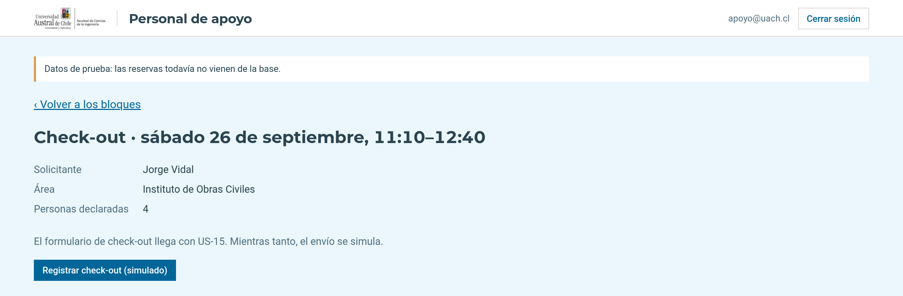

Un check-out completado no se puede enviar de nuevo. Al pulsar **Completado**
se ve quién lo registró y cuándo.

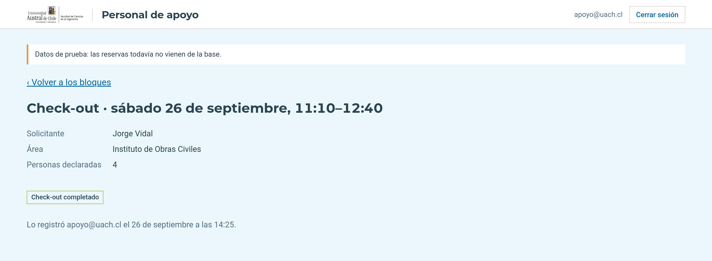

El registro queda en la base de datos y lo ve todo el personal de apoyo. Al abrirlo
se muestran sus preguntas originales, respuestas y evidencias. Las fotos solo se
descargan con una sesión de apoyo o administración. Las capturas de US-14 de arriba
corresponden al simulador anterior.

### Administrar el listado de check-out

En **Configuración → Check-out** (`/configuracion/checkout/`) el administrador puede
editar títulos y preguntas, añadir o eliminar secciones y preguntas, y cambiar su
orden con **Subir** y **Bajar**. Debe conservar al menos una sección con una pregunta.

Los botones de edición preparan los cambios; **Publicar listado** los guarda.
Todas las preguntas son obligatorias y cada **No** exige observación y foto:
el editor no permite quitar esa regla. Las preguntas nuevas heredan la validación.

Los reportes completados conservan una copia del listado que se respondió.
Si el listado cambia mientras alguien responde o edita, el servidor rechaza la
versión anterior y solicita recargar. Un envío con errores no registra el check-out;
hay que corregirlo y volver a seleccionar las fotos antes de enviarlo.

### Checklist de cierre de la sala: prototipo anterior

> **Referencia histórica.** Esta pantalla es el prototipo de US-15 y todavía no está
> en `main`: vive en la rama `feat/us-15-checkout-de-constancia`. Se abre en
> `/checklist/`, sin iniciar sesión, y muestra siempre la misma reserva de
> ejemplo (*Sala Virtual, 09:00 - 12:00*). El reporte queda guardado solo en el
> navegador: todavía no llega al sistema ni reemplaza el check-out de arriba.

Al terminar el uso de la sala, el personal de apoyo la revisa y deja constancia
de su estado. Son cuatro pasos; la barra de arriba dice en cuál vas y cuánto
falta.

| Paso | Qué se revisa |
|---|---|
| 1. Estado e integridad | Paredes y paneles acústicos sin daños; puerta y sellos acústicos funcionando |
| 2. Orden y limpieza | Sala sin basura ni objetos personales; mobiliario en su posición original |
| 3. Equipamiento técnico | Micrófonos y cables enrollados; consola y periféricos apagados; si algún equipo o cable presenta daños |
| 4. Cumplimiento y cierre | Si el ingreso y la desocupación fueron a la hora prevista, y la hora efectiva de salida |

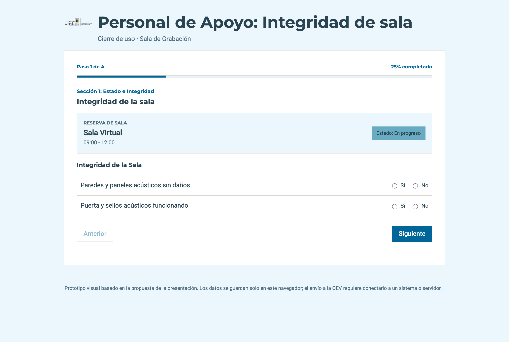

**Responder un paso**

1. Marca **Sí** o **No** en cada pregunta.
2. Si marcas **No**, aparecen dos campos obligatorios: una **Observación** de al
   menos 10 caracteres que explique el problema y una **Foto de integridad** de
   respaldo. **Quitar foto** la saca para adjuntar otra.
3. Pulsa **Siguiente**. **Anterior** vuelve al paso previo sin perder lo
   respondido.

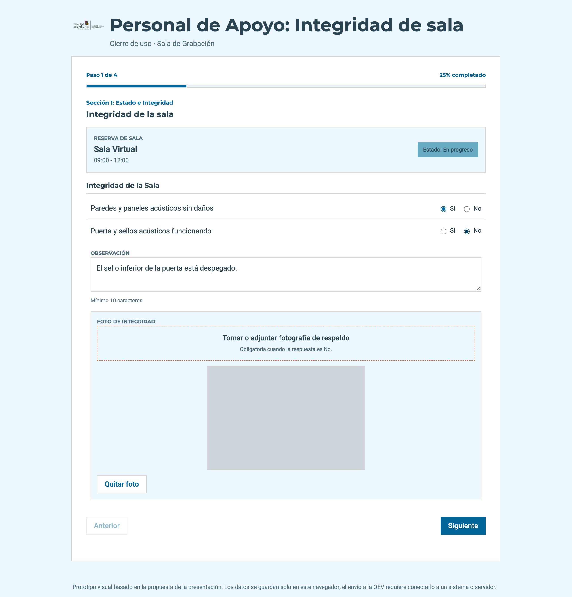

Si falta algo, el paso no avanza y el aviso aparece bajo los botones.

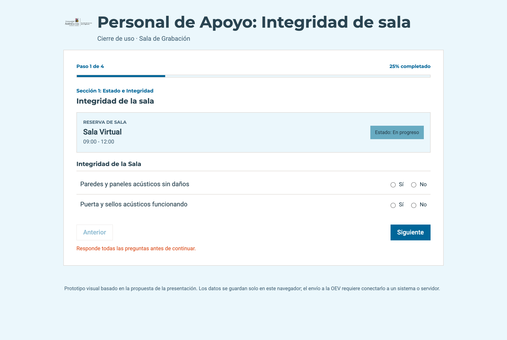

| Situación | Aviso |
|---|---|
| Una pregunta sin responder | Responde todas las preguntas antes de continuar. |
| Un No con una observación corta | Agrega una observación de al menos 10 caracteres para cada respuesta No. |
| Un No sin foto | Adjunta una foto de integridad para cada respuesta marcada como No. |
| El paso 4 sin hora de salida | Indica la hora efectiva de salida. |

**Cerrar la revisión**

En el paso 4, además de las dos preguntas:

1. Escribe la **Hora efectiva de salida** (obligatoria).
2. Agrega **Observaciones finales** si hace falta (opcional).
3. Adjunta la **Foto de fidelidad / entrega**, con el estado general de la sala
   al terminar (opcional).
4. Pulsa **Finalizar y enviar reporte**.

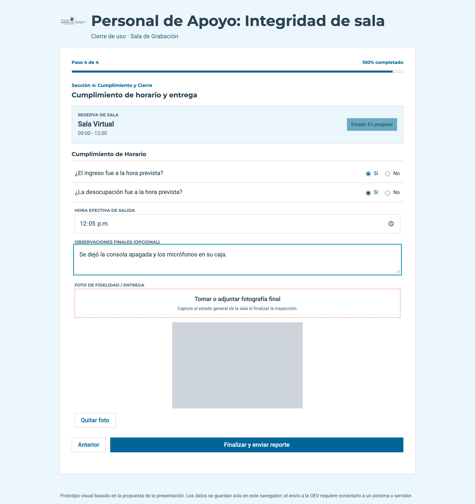

Aparece **Revisión finalizada** con el resumen: la sala, la hora de salida,
cuántas fotos de integridad se adjuntaron, si hay foto final y la fecha y hora
del registro. **Volver al inicio** empieza un checklist nuevo.

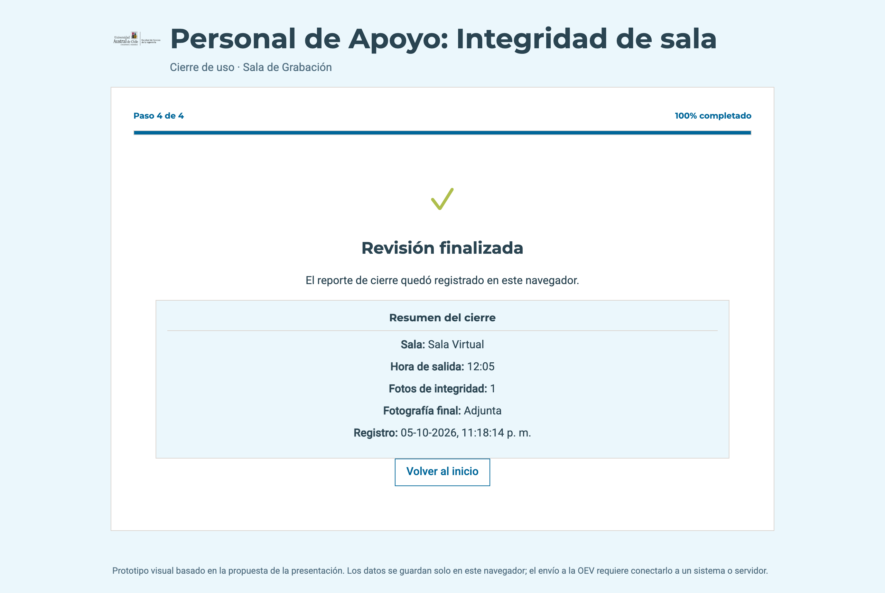
