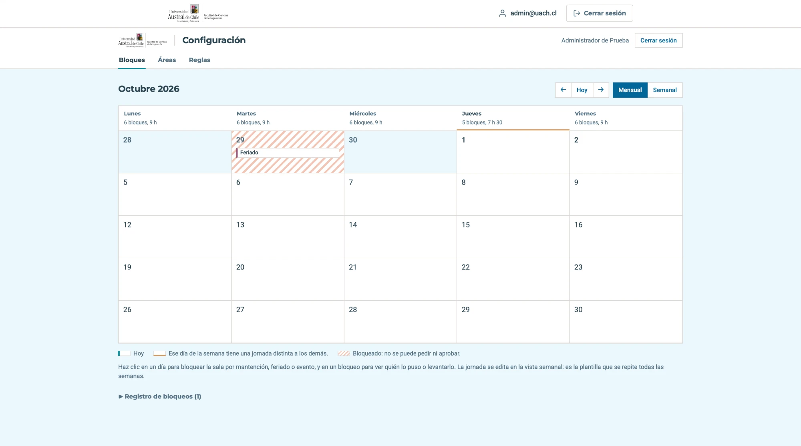

# Manual de uso

Sistema de gestión de horarios y uso de la sala de grabación de la Facultad de Ciencias de la Ingeniería, UACh.

Este manual cubre lo que hoy está disponible en el sistema:

| Historia | Quién la usa | Sección |
|---|---|---|
| US-01 Inicio de sesión | Todos | [Iniciar sesión](#1-iniciar-sesión) |
| US-02 Solicitud de reserva | Solicitante | [Solicitar una reserva](#4-solicitar-una-reserva) |
| US-03 Confirmar la asistencia | Solicitante | [Confirmar la asistencia](#confirmar-la-asistencia) |
| US-04 Panel de administrador | Administrador | [Configurar la sala](#2-configurar-la-sala) |
| US-07 Panel del validador | Validador | [Panel del validador](#5-panel-del-validador) |
| US-09 Historial de solicitudes | Solicitante | [Mis solicitudes](#mis-solicitudes) |
| US-14 Bloques del personal de apoyo | Personal de apoyo | [Bloques del día](#3-bloques-del-día) |
| US-15 Checkout de constancia | Personal de apoyo | [Checklist de cierre de la sala](#7-checklist-de-cierre-de-la-sala) |
| US-17 Bloquear fechas de la sala | Administrador | [Bloquear fechas de la sala](#6-bloquear-fechas-de-la-sala) |

## Puertas de acceso

Cada rol entra por su propia dirección. Solo la del solicitante está enlazada
desde el sitio; las otras tres las conoce quien las usa. Cada puerta se reconoce
por el panel de la izquierda, con el nombre y el color del rol.

| Rol | Dirección | Panel |
|---|---|---|
| Solicitante | `/solicitante/entrar/` | Azul, **Solicitantes** |
| Administrador | `/configuracion/entrar/` | Azul petróleo, **Administración** |
| Validador | `/validacion/entrar/` | Vino, **Validación** |
| Personal de apoyo | `/apoyo/entrar/` | Gris azulado, **Personal de apoyo** |

---

## 1. Iniciar sesión

### Entrar

1. Abre la dirección de tu rol.
2. Escribe tu correo institucional y tu contraseña. Marca **Ver contraseña** si
   quieres revisar lo que escribiste.
3. Pulsa **Iniciar sesión**. El sistema te lleva al panel de esa puerta. Si
   tienes más de un rol, la puerta por la que entras decide a qué panel llegas.

### Si no puedes entrar

Si el correo o la contraseña no coinciden, aparece el aviso **Correo o
contraseña incorrectos.**, junto con cuántos intentos seguidos bloquean la cuenta
y por cuántos minutos. El correo queda escrito para que no tengas que repetirlo.
Las mayúsculas del correo no importan.

El aviso es el mismo cuando el correo no existe, cuando la cuenta no tiene el rol
de esa puerta o cuando está bloqueada. Así nadie puede usar la pantalla para
averiguar qué cuentas existen.

Después de esos intentos fallidos seguidos, la cuenta se bloquea por esos
minutos: mientras dure, ni la contraseña correcta la abre. Cuántos intentos y
cuántos minutos lo decide el administrador (ver
[Reglas](#reglas-los-parámetros-del-sistema)).

### Recuperar la contraseña

1. En la pantalla de ingreso, pulsa **¿Olvidaste tu contraseña?**.
2. Escribe tu correo y pulsa **Enviar enlace**.
3. Abre el enlace que llega a tu correo, escribe la contraseña nueva dos veces y
   pulsa **Guardar**.
4. Con el mensaje **Listo**, vuelve a iniciar sesión con la contraseña nueva.

El enlace sirve una sola vez y vence en unas horas. Si ya no funciona, la
pantalla ofrece **Pedir otro enlace**.

---

## 2. Configurar la sala

El panel del administrador tiene cuatro pestañas: **Bloques**, **Áreas**,
**Reglas** y **Validación**. Se entra por `/configuracion/entrar/`.

### Bloques: la jornada semanal

Un bloque es un tramo horario de un día de la semana, por ejemplo *lunes de
08:10 a 09:40*. La jornada se define una vez y se repite todas las semanas.

**Agregar un bloque**

1. En la vista **Semanal**, haz clic en un hueco de la columna del día o pulsa
   **+** junto al nombre del día.
2. Ajusta **Inicio** y **Término** en el editor de abajo. La **Duración** se
   calcula sola.
3. Pulsa **Agregar el bloque**.

**Editar o quitar un bloque**

1. Haz clic sobre el bloque. Queda marcado y se abre el editor.
2. Cambia las horas y pulsa **Guardar el bloque**, o pulsa **Quitar de la
   jornada**. **Cancelar** cierra el editor sin cambios.

Si el bloque se cruza con otro del mismo día, no se guarda: aparece un aviso y
el otro bloque queda marcado. Quitar un bloque no pide confirmación; en su lugar
aparece **Reponerlo**, por si fue un error. Un bloque quitado nunca se borra,
así que las solicitudes que ya lo apuntan siguen siendo válidas.

**Vista mensual**

La vista **Mensual** muestra el mes completo, con cuántos bloques y horas tiene
cada día de la semana. Sirve para revisar, no para editar. Con **←**, **Hoy** y
**→** te mueves entre meses.

### Áreas

La pestaña **Áreas** todavía no tiene contenido. Llega con US-05.

### Reglas: los parámetros del sistema

Aquí se ajustan los umbrales con los que opera el sistema, sin reinstalar nada.
Cada fila explica qué hace el sistema con ese valor.

| Grupo | Parámetros |
|---|---|
| Recepción de solicitudes | Día y hora límite para pedir la semana siguiente, desfase mínimo en semanas |
| Reserva | Días de anticipación para confirmar, tope mensual por persona, bloques por solicitud |
| Cierre y sanciones | Inasistencias para sancionar, duración de la sanción |
| Acceso | Intentos antes de bloquear una cuenta, duración del bloqueo |
| Términos y condiciones | El texto que acepta el solicitante al enviar una solicitud |

Para cambiar valores:

1. Modifica los que necesites.
2. Pulsa **Guardar cambios**.

Si un valor está fuera de su rango permitido, la fila se marca y no se guarda
nada. Los cambios rigen para las solicitudes nuevas; las que ya se enviaron no
cambian.

Al final de la página, **Últimos cambios** muestra quién cambió cada parámetro,
cuándo y de qué valor a cuál.

---

## 3. Bloques del día

La vista del personal de apoyo muestra las reservas de la sala para un día. Se
entra por `/apoyo/entrar/`.

### Dar el rol a alguien

El rol se asigna desde `/admin` con la cuenta de administrador: en **Usuarios**,
abre la cuenta de la persona, agrégale el grupo **Personal de apoyo** y guarda.
Una persona puede tener más de un rol a la vez.

### Leer la lista

Al entrar se ven las reservas de hoy, ordenadas por hora de inicio.

| Columna | Qué indica |
|---|---|
| Hora | Inicio y término del bloque |
| Solicitante | Quién pidió la sala |
| Área | El área académica de la reserva |
| Personas | Cuántas personas declaró el solicitante |
| Estado | **Aprobada** o **Confirmada**. Una **Cancelada** aparece tachada: ya no hay que esperar a nadie |
| Check-out | **Completado** si ya se registró, **Hacer check-out** si el bloque terminó y falta, o **—** si el bloque aún no termina o se canceló |

Las reservas pendientes de aprobación no aparecen, porque todavía pueden
rechazarse. Todo el personal de apoyo ve todos los bloques; no se asignan a una
persona en particular.

### Cambiar de día

Usa **‹** y **›** para ir al día anterior o al siguiente, **Hoy** para volver al
día actual, o el selector de fecha para saltar a cualquier día.

### Hacer el check-out

El botón **Hacer check-out** aparece recién cuando termina el bloque.

1. Pulsa **Hacer check-out** en la fila del bloque.
2. Revisa los datos del bloque y pulsa **Registrar check-out (simulado)**.
3. El sistema vuelve a la lista y el bloque aparece como **Completado**.

Un check-out completado no se puede enviar de nuevo. Al pulsar **Completado**
se ve quién lo registró y cuándo.

> **Estado actual.** La lista muestra los bloques de las solicitudes aceptadas
> en el panel del validador (sección 5). El formulario de check-out con el
> checklist de la sala llega con US-15; hasta entonces el registro es simulado y
> solo lo ve quien lo envió.

---

## 4. Solicitar una reserva

Aquí se pide una reserva de la sala de grabación. Se entra por
`/solicitante/entrar/` y el formulario está en `/solicitar/`. Son tres pasos:
**Horario y disponibilidad**, **Datos de la actividad** y **Confirmación**.
Enviar la solicitud no la confirma: queda **en revisión** hasta que la acepte un
validador (US-07).

### Antes de empezar

Tu cuenta necesita el rol **Solicitante** y al menos un área académica activa.
Si no perteneces a ninguna, en vez del formulario aparece el aviso **No puedes
solicitar todavía**, que te pide pedirle al administrador que te asocie a tu
área.

Mientras la pestaña **Áreas** no tenga contenido (US-05), el rol y las áreas se
asignan desde `/admin` con la cuenta de administrador: en **Usuarios**, abre la
cuenta de la persona, agrégale el grupo **Solicitante** y sus áreas, y guarda.

### Elegir el área académica

Si perteneces a más de un área, lo primero es elegir para cuál es la grabación.
Selecciónala y pulsa **Continuar al calendario**. Si perteneces a una sola, este
paso no aparece.

Para cambiarla después, pulsa **Cambiar área** en el paso 1. Cambiar de área
borra el día y los bloques que ya habías marcado.

### Paso 1: elegir el día y los bloques

1. En el calendario, los días que se pueden pedir aparecen destacados y con un
   punto. Arriba se indica desde qué fecha se puede solicitar: entre la
   solicitud y la grabación tienen que pasar las semanas de desfase que fija el
   administrador (ver [Reglas](#reglas-los-parámetros-del-sistema)). Sábados y
   domingos no se pueden pedir.
2. Para moverte entre meses usa **Anterior** y **Siguiente**, o los selectores
   de mes y año. Solo se puede pedir con unos meses de anticipación.
3. Haz clic en un día. Abajo aparecen sus bloques horarios.
4. Marca uno o más bloques. Cada uno dice **Disponible** o, al marcarlo,
   **Seleccionado**. Los que ya están reservados no aparecen, y los que ya
   pediste tú aparecen como **Ya solicitaste este bloque · Pendiente** y no se
   pueden marcar de nuevo.
5. Pulsa **Continuar a datos de la actividad**.

### Paso 2: completar los datos de la actividad

1. Arriba se ve el día y los bloques elegidos. **Cambiar horario** vuelve al
   paso 1.
2. **Solicitante.** Tu nombre, tu correo y el área elegida, tomados de tu
   cuenta. No se pueden cambiar aquí.
3. **Motivo de la solicitud** (obligatorio, hasta 300 caracteres). Para qué
   usarás la sala, por ejemplo *grabación de cápsula para el módulo de Bases de
   Datos*.
4. **Cantidad de personas en sala.** De 1 a 5, contándote a ti. Por cada
   persona adicional aparece un recuadro **Acompañante** para su nombre y
   correo, hasta 4 acompañantes.
5. Pulsa **Continuar a confirmación**. **Volver al calendario** regresa al paso
   1.

Si algo no cuadra, el paso 2 vuelve con lo que escribiste y el aviso
correspondiente. Por ejemplo, al declarar 3 personas con un solo acompañante
completo:

### Paso 3: revisar y enviar

1. Revisa el **Resumen de la reserva**: fecha, horario, solicitante, área,
   motivo, personas y acompañantes. **Modificar datos** vuelve al paso 2.
2. Lee los **Términos y condiciones** y marca **He leído y acepto los términos
   y condiciones de uso de la sala**. El botón no se activa hasta marcar la
   casilla.
3. Pulsa **Confirmar y enviar solicitud**.

Al enviarla aparece **Solicitud completa**, con el número de la solicitud, que
queda en revisión, y el resumen de lo enviado. **Hacer otra solicitud** empieza
de nuevo.

### Avisos del formulario

| Paso | Situación | Aviso |
|---|---|---|
| Área | No se eligió un área | Por favor, selecciona un área académica para continuar. |
| 1 | No se eligió un día | Por favor, selecciona un día disponible en el calendario. |
| 1 | El día está fuera del período que se puede pedir | La fecha seleccionada no está dentro del período permitido. |
| 1 | No se marcó ningún bloque | Por favor, selecciona al menos un bloque de horario para continuar. |
| 1 | Alguien reservó un bloque mientras lo elegías | Uno o más de los bloques seleccionados ya no están disponibles. Por favor, selecciona otros. |
| 2 | Falta el motivo | El motivo es obligatorio. |
| 2 | Más de 5 personas en sala | Como máximo 5 personas en sala. |
| 2 | Menos de 1 persona en sala | Al menos tienes que entrar tú. |
| 2 | Faltan datos de acompañantes, por ejemplo 3 personas con 1 acompañante completo | Declaraste 3 personas en sala, así que faltan los datos de 2 acompañante(s); tienes 1 completo(s). |
| 2 | Un acompañante tiene nombre pero no correo, o al revés | Falta el correo de esta persona. / Falta el nombre de esta persona. |
| 2 | Dos acompañantes tienen el mismo correo | Hay un correo repetido entre los acompañantes. |
| 2 | Se incluyó tu propio correo como acompañante | Tu propio correo ya está incluido: eres parte de la cuenta de personas. |
| 3 | No se aceptaron los términos | Tienes que aceptar los términos y condiciones para enviar la solicitud. |

Lo que eliges en cada paso queda guardado mientras completas el formulario. La
solicitud se registra recién al pulsar **Confirmar y enviar solicitud**.

### Mis solicitudes

La pestaña **Mis solicitudes**, arriba junto a **Solicitar reserva**, muestra
todas tus solicitudes, de cualquiera de tus áreas, con su estado actual. Está en
`/solicitar/mis-solicitudes/`.

Se separan en dos pestañas, cada una con cuántas tiene:

- **Próximas**: las de hoy en adelante, la más cercana primero. Una de hoy sigue
  aquí aunque su hora ya haya pasado.
- **Anteriores**: las de días que ya pasaron, la más reciente primero.

Cada fila dice el número de la solicitud, el área, la fecha, los bloques y el
estado. Se muestran de a 20; si hay más, abajo aparecen **Anterior** y
**Siguiente**.

| Estado | Qué significa |
|---|---|
| **En revisión por la Oficina** | La Oficina todavía no la revisa. Se puede **Retirar** |
| **Aceptada** | La Oficina la aceptó. Falta confirmar la asistencia: aparece **Confirmar asistencia** |
| **Pendiente de confirmación** | Aceptada y esperando que confirmes. También aparece **Confirmar asistencia** |
| **Confirmada** | Confirmaste que vas a usar la sala |
| **Rechazada** | La Oficina la rechazó. Debajo va el motivo que escribió |
| **Cancelada** | Se canceló después de aceptada |
| **Retirada** | La retiraste antes de que la Oficina la revisara |

**Retirar una solicitud**

Solo se puede retirar una solicitud **En revisión por la Oficina**. Una vez
aceptada o rechazada, el botón ya no aparece.

1. Pulsa **Retirar** en la fila de la solicitud.
2. Se abre un recuadro que pide confirmarlo. **Retirar solicitud** la retira;
   **Cancelar**, Esc o un clic fuera del recuadro lo cierran sin cambiar nada.

La solicitud queda **Retirada** en la misma pestaña, con el aviso **Retiraste la
solicitud #… Su horario queda libre.** No se borra: sigue en el historial. Si la
Oficina la revisó justo antes, el aviso dice que ya no está en revisión y no
cambia nada.

### Confirmar la asistencia

Cuando la Oficina acepta una reserva llega un correo con un enlace para
confirmarla. El mismo enlace está en **Mis solicitudes**, como **Confirmar
asistencia** bajo el estado de cada reserva aceptada.

| Paso | Qué pasa |
|---|---|
| Abrir el enlace | Sin sesión iniciada, pide entrar y después vuelve a la reserva |
| Ver la reserva | Muestra la fecha, el horario, el área y el motivo. Abrirla no confirma nada |
| **Confirmar asistencia** | La reserva queda **Confirmada** y vuelve a Mis solicitudes con el aviso |

Al confirmar, vuelves a **Mis solicitudes** con el aviso **Confirmaste tu
asistencia a la reserva #…** y la fila queda **Confirmada**.

Se puede confirmar hasta el día anterior a la reserva. Si ya está confirmada,
cancelada o es el mismo día, la página lo dice y no muestra el botón.

---

## 5. Panel del validador

Aquí el validador revisa las solicitudes pendientes y aprueba o rechaza cada
solicitud entera. Se entra por `/validacion/entrar/` y el panel está en
`/validador/`. El administrador tiene el mismo panel en la pestaña
**Validación** de `/configuracion/`.

| Al resolver | Qué pasa |
|---|---|
| Aprobar | La solicitud queda **Aceptada** y su bloque deja de ofrecerse en el calendario |
| Rechazar | La solicitud queda **Rechazada** con el motivo |
| En ambos casos | Queda guardado quién resolvió, a qué hora y con qué motivo. El solicitante recibe un correo y ve el resultado en **Mis solicitudes** |

### Dar el rol a alguien

El rol se asigna desde `/admin` con la cuenta de administrador: en **Usuarios**,
abre la cuenta de la persona, agrégale el grupo **Validador** y guarda.

### Leer el panel

**Bloques de la semana**, en la columna izquierda, es un calendario de lunes a
viernes con los bloques de la jornada:

| Casilla | Qué indica |
|---|---|
| Vacía | Libre |
| Borde gris con un número | Una solicitud pendiente |
| Borde rojo con un número | Tope: varias solicitudes piden ese bloque. El número dice cuántas |
| Verde | Aprobado, con el número de la solicitud |

Al hacer clic en una casilla, el panel baja a la solicitud o al tope
correspondiente.

Arriba a la derecha, el resumen dice cuántos bloques quedan **pendientes**,
cuántos tienen **tope** y cuántos están **resueltos**.

Cada tarjeta tiene además un mini calendario con sus bloques: borde azul es un
pedido pendiente, borde rojo con número es un tope, verde es aprobado y rayado
es rechazado.

### Con tope

Agrupa los bloques que piden dos o más solicitudes en la misma fecha y hora.
Esos bloques se resuelven solo aquí.

Cada tarjeta muestra el bloque, las solicitudes que lo piden, ordenadas por
prioridad del área (P1 primero), y una sugerencia según esa prioridad. De cada
solicitud se ve el encargado, el área, el motivo y las personas, y si pide otros
bloques también se indica.

Para resolver un tope:

1. Escribe el **Motivo de la resolución** (mínimo 10 caracteres). Es el motivo
   que recibe quien no obtiene el bloque.
2. Pulsa **Aprobar esta solicitud** en la elegida. Las demás que chocan con
   ella quedan rechazadas enteras, con ese motivo.
3. También puedes **Rechazar** una solicitud en particular, con el mismo
   motivo. Si en el bloque queda una sola, pasa a **Sin tope**.

Si pulsas **Aprobar esta solicitud** o **Rechazar** sin motivo, la tarjeta lo
avisa y deja el cursor en el campo.

Al aprobar, la casilla del calendario queda verde con el número de la solicitud
y el tope sale de la lista.

### Sin tope

Muestra una tarjeta por solicitud con bloques que nadie más pide: encargado,
área, motivo, observaciones, personas y acompañantes, fecha de envío y su mini
calendario.

La solicitud se resuelve entera:

- **Aprobar solicitud**: se aprueba de inmediato.
- **Rechazar solicitud**: abre el campo **Motivo del rechazo** (mínimo 10
  caracteres) y luego **Confirmar rechazo**. Si el motivo es corto, el aviso
  sale en la misma tarjeta. **Cancelar** o Esc lo cierran.

Una solicitud que choca con otra en algún bloque no aparece aquí: se resuelve
en **Con tope**.

### Resueltas

Un registro de lo resuelto en la sesión: bloque, solicitud, resultado, motivo,
validador y hora. Al recargar la página ya no aparecen, porque el panel muestra
solo lo pendiente; lo resuelto queda guardado.

| Aviso | Cuándo |
|---|---|
| Esta solicitud ya fue resuelta o retirada. | Otro validador la resolvió, o el solicitante la retiró, mientras tenías la página abierta |
| Uno de sus bloques ya está aprobado para otra solicitud ese día. | El bloque se aprobó para otra solicitud |
| La sala está bloqueada a las …: no se puede aprobar. | Hay un bloqueo en ese horario; se rechaza con ese motivo |
| No se pudo guardar. Recarga la página e inténtalo de nuevo. | La sesión venció o se perdió la conexión |

---

## 6. Bloquear fechas de la sala

El administrador puede dejar la sala fuera de servicio por una **mantención**,
un **feriado** o un **evento**. El bloqueo vale para fechas concretas: la
jornada semanal sigue igual. Mientras está vigente, esos horarios no se pueden
solicitar ni aprobar, y quien solicita ve el motivo.

Se entra con la cuenta de administración por `/configuracion/entrar/`, pestaña
**Bloques** (`/configuracion/bloques/`). La vista **Mensual** sirve para crear y
revisar bloqueos; la **Semanal** muestra la jornada de una semana concreta y
permite bloquear un bloque en una fecha.

### Crear un bloqueo

1. En la vista mensual, haz clic en el día que quieres bloquear.
2. En **Qué bloquear**, elige una opción:
   - **Todo el día**.
   - **Un bloque**, por ejemplo de 08:10 a 09:40.
   - **Varios días**: bloquea los días completos entre la fecha elegida y la
     que marques como término. Puedes marcarla con otro clic en el calendario.
3. Elige el **Motivo**: Mantención, Feriado o Evento. Si quieres, agrega un
   **Detalle**, como *Taller de profesores*. El solicitante lo ve.
4. Pulsa **Bloquear**.

El día queda marcado en el calendario y arriba del registro aparece la
confirmación, por ejemplo **Bloqueaste la sala el martes 6 de octubre, de 08:10
a 09:40 (Evento: Taller de profesores).**

No se puede bloquear un día que ya pasó, una fecha sin jornada ni algo que ya
está bloqueado entero. Si el bloqueo le quita la sala a reservas aprobadas que
todavía no empiezan, el sistema no lo guarda a la primera: muestra esas
reservas para que revises a quién afecta. Al confirmar, guarda el bloqueo y
avisa por correo a cada persona afectada.

### Ver y levantar un bloqueo

Los días bloqueados aparecen rayados. Haz clic en el bloqueo para ver su motivo
y quién lo registró. Para devolver el horario, escribe el **Motivo para
levantarlo** y pulsa **Levantar el bloqueo**.

El horario vuelve a estar disponible y queda anotado quién levantó el bloqueo,
cuándo y por qué. Un bloqueo que ya pasó no se puede levantar.

El **Registro de bloqueos**, al final de la vista mensual, muestra las últimas
acciones, bloqueos y levantamientos, con fecha, qué se bloqueó, motivo y
responsable.

### Bloquear desde la vista semanal

La vista semanal dice qué semana es, por ejemplo **Semana del 28 de septiembre
al 2 de octubre de 2026**, y cada columna muestra su fecha. Para cambiar de
semana usa **←**, **Hoy** y **→**, o haz clic en un día del mini calendario de la
izquierda. Los bloques bloqueados en esa semana aparecen rayados.

Para bloquear un bloque en una fecha, haz clic en el bloque, pulsa **Bloquear
una fecha**, elige la fecha (viene elegida la de la semana que estás mirando),
el motivo y pulsa **Bloquear esa fecha**.

### Cómo se relaciona con la jornada

La jornada semanal se configura aparte y se repite todas las semanas. Un
bloqueo afecta solo la fecha o el rango indicado: no quita ni cambia los bloques
de la jornada. Así, un evento puede cerrar el bloque del martes 6 de octubre de
08:10 a 09:40 sin cerrar ese horario los martes siguientes. La vista semanal lo
recuerda con un aviso fijo: los horarios valen para todas las semanas; los
bloqueos, solo para su fecha.

> **Estado actual.** Las reservas que un bloqueo afecta son las solicitudes
> aceptadas y no canceladas de esas fechas. En desarrollo, los correos de aviso
> se escriben en el log del contenedor en vez de enviarse.

---

## 7. Checklist de cierre de la sala

> **Estado actual.** Esta pantalla es el prototipo de US-15 y todavía no está
> en `main`: vive en la rama `feat/us-15-checkout-de-constancia`. Se abre en
> `/checklist/`, sin iniciar sesión, y muestra siempre la misma reserva de
> ejemplo (*Sala Virtual, 09:00 - 12:00*). El reporte queda guardado solo en el
> navegador: todavía no llega al sistema ni reemplaza el check-out de la
> sección 3.

Al terminar el uso de la sala, el personal de apoyo la revisa y deja constancia
de su estado. Son cuatro pasos; la barra de arriba dice en cuál vas y cuánto
falta.

| Paso | Qué se revisa |
|---|---|
| 1. Estado e integridad | Paredes y paneles acústicos sin daños; puerta y sellos acústicos funcionando |
| 2. Orden y limpieza | Sala sin basura ni objetos personales; mobiliario en su posición original |
| 3. Equipamiento técnico | Micrófonos y cables enrollados; consola y periféricos apagados; si algún equipo o cable presenta daños |
| 4. Cumplimiento y cierre | Si el ingreso y la desocupación fueron a la hora prevista, y la hora efectiva de salida |

### Responder un paso

1. Marca **Sí** o **No** en cada pregunta.
2. Si marcas **No**, aparecen dos campos obligatorios: una **Observación** de al
   menos 10 caracteres que explique el problema y una **Foto de integridad** de
   respaldo. **Quitar foto** la saca para adjuntar otra.
3. Pulsa **Siguiente**. **Anterior** vuelve al paso previo sin perder lo
   respondido.

Si falta algo, el paso no avanza y el aviso aparece bajo los botones.

| Situación | Aviso |
|---|---|
| Una pregunta sin responder | Responde todas las preguntas antes de continuar. |
| Un No con una observación corta | Agrega una observación de al menos 10 caracteres para cada respuesta No. |
| Un No sin foto | Adjunta una foto de integridad para cada respuesta marcada como No. |
| El paso 4 sin hora de salida | Indica la hora efectiva de salida. |

### Cerrar la revisión

En el paso 4, además de las dos preguntas:

1. Escribe la **Hora efectiva de salida** (obligatoria).
2. Agrega **Observaciones finales** si hace falta (opcional).
3. Adjunta la **Foto de fidelidad / entrega**, con el estado general de la sala
   al terminar (opcional).
4. Pulsa **Finalizar y enviar reporte**.

Aparece **Revisión finalizada** con el resumen: la sala, la hora de salida,
cuántas fotos de integridad se adjuntaron, si hay foto final y la fecha y hora
del registro. **Volver al inicio** empieza un checklist nuevo.

